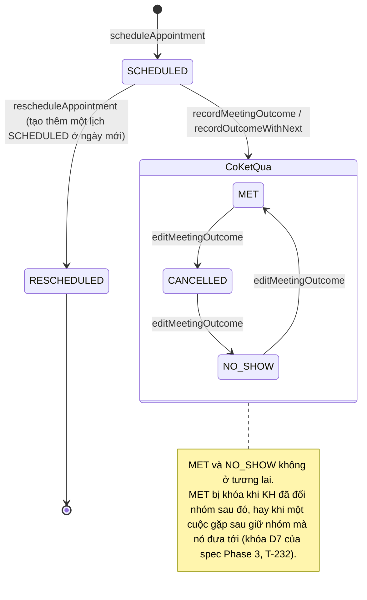

# State machine trong app — danh mục

Mọi chỗ trong app mà một thứ đi qua nhiều trạng thái theo luật: trạng thái nào có, đi sang đâu được, **luật nằm ở đâu**. Đọc trước khi thêm trạng thái / lệnh / nút cho một thực thể, hay sửa một luồng bận / hủy / lỗi. Rà ngày 09/11/2026 trên `main` `95f5e20` (code cuối `a1e6a20`). Tên hàm và hằng ổn định hơn số dòng: tìm bằng tên. Mã D1–D7, R1–R6, U1–U8, P1–P3 là của riêng file này, khác mã quyết định D1–D10 của `docs/design/phase-3-du-lieu.md` mà comment trong code hay trích ("(D3)", "(D7)"); file này ghi mã của spec kèm tên spec ("khóa D7 của spec Phase 3").

- **Tường minh:** luật ở một chỗ (hàm thuần, union, bảng), chỗ khác đọc chỗ đó.
- **Ngầm:** luật là các `if` lặp lại ở nhiều nơi, hoặc trạng thái là tổ hợp của nhiều biến cờ.
- Một chuyển trạng thái của dữ liệu lưu bị chặn ở bốn lớp: CHECK của SQLite (`packages/db/src/schema.ts`) giữ bất biến theo trạng thái; lệnh db (transaction, `DbError`) giữ luật chuyển; `packages/db/src/backup-validation.ts` kiểm lại khi nhập backup; UI chỉ bày nút / lựa chọn mà lệnh nhận.

## 1. Dữ liệu lưu

| # | Máy | Trạng thái | Mức | Luật nằm ở |
|---|---|---|---|---|
| D1 | Nhóm KH (`CustomerStage`) | N4, N3, N2, N1, `ON_HOLD`, `LOST` | **Tường minh — mẫu chuẩn** | `assertValidTransition` (`packages/domain/src/customer-lifecycle.ts`): lệnh db (`checkTransition` ở `packages/db/src/customers.ts`), nhập backup và UI (`allowedStages` ở `apps/desktop/src/routes/customers/customers-view.ts`) cùng gọi một hàm |
| D2 | Cuộc hẹn (`AppointmentStatus`) | `SCHEDULED`, `MET`, `RESCHEDULED`, `CANCELLED`, `NO_SHOW` | **Ngầm** | Rải ở 2 package, 3 cách viết cùng một luật — xem §4 |
| D3 | HĐ (`Policy`) | đã nộp → phát hành (UI không cho về lại; `updatePolicy` cho) | Ngầm, đủ chặn | Không có trường trạng thái: suy từ cặp `issuedDate` / `issuedFyp`. CHECK `policies_issued_pair`, `policies_issued`; `validate` ở `packages/db/src/policies.ts` (`ISSUE_INCOMPLETE`, `ISSUED_BEFORE_SUBMITTED`); UI giữ union `issued: null \| {…}` (`openDraft`, `policyStatusText` ở `apps/desktop/src/routes/customers/policy-form.ts`). Kiểu `Policy` của domain cho phép nửa cặp, CHECK chặn |
| D4 | Dữ kiện KYC (`KycFactStatus`), theo từng trường | chưa có → `active`; `active` → `superseded` + `active` mới; `active` → `conflict`; `conflict` → một `active`, còn lại `superseded` | Tường minh | Phép thuần `confirmFact`, `markConflict`, `resolveConflict` (`packages/domain/src/kyc.ts`); db `confirmKycFact`, `markKycConflict`, `resolveKycConflict` lưu phần khác; nhập backup đếm `active` / `conflict` mỗi trường |
| D5 | Phân tích AI (`ai_analyses`) | `ACCEPTED` / `REJECTED` lưu; `CURRENT` / `STALE` / `REJECTED` suy ra | Tường minh, không đổi sau khi ghi | Chỉ thêm (trigger chặn sửa / xóa); CHECK theo `status`; `listAiAnalyses` suy `AiAnalysisState` (`packages/db/src/ai-analyses.ts`) |
| D6 | Xóa mềm (KH, cuộc hẹn, HĐ, nhân sự, team) | còn → đã xóa (`deleted_at`) → khôi phục, hoặc xóa hẳn | Tường minh | `softDelete*`, `restore*` + `checkRestore*` từng thực thể; `previewPurge` / `purgeTrash` / `keptRecords` (`packages/db/src/purge.ts`) |
| D7 | Cổng KYC (`KycGateState`) | `CONFLICT_RESOLUTION` > `KYC_INSUFFICIENT` > `PROFILE_DISCOVERY` > `PAIN_POINT_ANALYSIS` | Hàm phân loại, không nhớ trạng thái | `evaluateKycGate` (`packages/domain/src/kyc-gate.ts`) |

## 2. Lúc chạy (bộ nhớ, Rust)

| # | Máy | Trạng thái | Mức | Luật nằm ở |
|---|---|---|---|---|
| R1 | Hàng đợi ghi file | rảnh / đang ghi / đang ghi + chờ; × lỗi | Ngầm trong biến (`waiting`, `running`, `lost`, `tracked`), gói kín trong một module, một kho `status()` | `createPersistQueue` (`apps/desktop/src/data/persist-queue.ts`); nhiều ca DR6 (DR6-139, DR6-162) |
| R2 | Thay dữ liệu (Nạp lại, Nhập backup, Dọn sạch) | rảnh / đang thay (xếp hàng), `generation` tăng mỗi lần thay | Gói kín | `replacing` + chuỗi `replaces`, từ chối `DATA_REPLACING` (`apps/desktop/src/data/app-data.ts`) |
| R3 | Đóng cửa sổ exe | lưu → (lỗi) hỏi → thử lại / bỏ / ở lại → đóng | Tường minh (vòng async) | `closeAfterSaving`, `askWhileFailed` (`apps/desktop/src/shell/close-guard.ts`) |
| R4 | Job AI (phân tích theo KH, trích xuất theo ghi chú) | không có → đang chạy → (Hủy) đang hủy → không có; kết quả giữ theo `generation` | Tường minh | `createAiJobs` (`apps/desktop/src/data/ai-jobs.ts`), `useAiJob` (`apps/desktop/src/routes/customers/use-ai-job.ts`) → `AiJobPhase`; union `AiPanelRun` + `runAfter` / `panelRun` (`apps/desktop/src/routes/customers/ai-panel-view.ts`) |
| R5 | Rust: một request AI, một lệnh file | rảnh / bận | Tường minh | `ai::Busy` + guard `Running` (`apps/desktop/src-tauri/src/ai.rs`); `storage::DataLock` (`Mutex<Held>`, `page` của lần `open` cuối; `apps/desktop/src-tauri/src/storage.rs`) |
| R6 | Khởi động | đang mở → app / trang lỗi | Tường minh | `openAppData(...).then(App, StartupError)` (`apps/desktop/src/main.tsx`), `startupMessage` (`apps/desktop/src/shell/startup-error.ts`) |

## 3. UI

| # | Máy | Biến giữ trạng thái | Mức | Ghi chú |
|---|---|---|---|---|
| U1 | Phiên ChatGPT web (`KycIntelligence` ở `apps/desktop/src/routes/customers/KycIntelligence.tsx`) | `startingWeb`, `webFailed`, `kept` (+ `generation`), `webEnded` | **Ngầm** | Bốn biến cho một tiến trình rảnh / đang mở / đang có phiên / lỗi. Tổ hợp vô lý (`webFailed` cùng phiên đang mở) chỉ bị giấu bằng điều kiện render (`webFailed && !web`). Ngay cạnh đó, phần Phân tích đã là union `AiPanelRun` |
| U2 | Cài đặt → Dữ liệu (`DataFileSection`, `BackupSection`, `DemoSection`) | thông báo đã chung (DR6-45, `noticeOf`); bận thì riêng từng mục (`busy`, `confirming`, `running` của `ConfirmWordDialog`) | **Ngầm** | Ghi chú **DR6-200** (Low / E; P2 sửa): "Nạp lại…" bấm được lúc đang đọc file backup, 10a chồng 10c, 10c giữ số đếm cũ. Dữ liệu vẫn an toàn nhờ R2 |
| U3 | Xuất / nhập backup (`BackupSection`) | `busy: 'export' \| 'read' \| null`, `chosen`, `refused` | Gần tường minh | `chosen` và `refused` loại trừ nhau theo luồng `readFile` |
| U4 | API key (`KeyCard` ở `apps/desktop/src/routes/SettingsAi.tsx`) | `stored`, `text`, `fieldError`, `outcome`, `working`, `confirming` + bộ đếm `actions` | Ngầm, nhỏ | `actions` là thẻ chống kết quả đọc cũ (DR5-37, R2-14); nhất quán |
| U5 | Hộp thoại "một trong N" | `AppointmentsScreen`: `creating`, `moving`, `recording`, `editing`, `deleting`; `CustomerProfile`: `editing`, `confirming`, `appointing`, `policyMode`, `marked`; `SettingsTrash`: `restoring`, `purging` | Ngầm, không tới được | Kiểu cho phép hai hộp mở cùng lúc, nhưng hộp là modal nên không bấm được nút thứ hai |
| U6 | Xác nhận hai bước | `asked` / `final` (`PersonDialogs`, `TeamDialogs`), `deleting` (`EditOutcomeDialog`, `PolicyDialogs`, `CustomerDialogs`) | Cục bộ | Nhỏ, một component |
| U7 | Hộp 6c / 6f (`OutcomeDialog`, `EditOutcomeDialog`) | `status`, `booking`, `noStatus`, `kycNote`, `errors` | Form | Lựa chọn trạng thái đọc `outcomeChoices` (D2) |
| U8 | Xuất Excel (`ReportExport`) | `busy` + kết quả union `{ kind: 'failed', step: ExportStep }` | Tường minh | |

## 4. D2 — cuộc hẹn

(Trong `CoKetQua` đi được giữa mọi cặp; hình chỉ vẽ một vòng. `RESCHEDULED` là trạng thái cuối. Trong ghi chú của sơ đồ không dùng dấu `;`: Mermaid đọc nó là hết câu.)

Luật này đang nằm ở:

- `packages/db/src/appointments.ts`: `recordMeetingOutcome` từ chối `RESCHEDULED`; `recordOutcomeWithNext` và `rescheduleAppointment` chỉ nhận `SCHEDULED`; `editMeetingOutcome` chỉ nhận `OUTCOME_STATUSES`; `outcomeFields` (đích ∈ `OUTCOME_STATUSES`, `stageAfter` / `nextStep` / người đánh giá chỉ khi `MET`); `requireOutcomeDay`; `checkRestoreAppointment`. `softDeleteAppointment` nhận mọi trạng thái.
- `packages/db/src/schema.ts`: CHECK `appointments_status`, `appointments_stage_after`, `appointments_met_outcome`, `appointments_outcome_reviewer`.
- `packages/db/src/backup-validation.ts`: chuỗi dời lịch (`rescheduled_from_id` trỏ tới lịch `RESCHEDULED` cùng KH), lịch `MET` với chuyển nhóm của nó.
- `apps/desktop/src/routes/appointments/outcome-form.ts`: `outcomeChoices` (lựa chọn nào tắt), `outcomeLock` (khóa D7 của spec Phase 3).
- `apps/desktop/src/routes/appointments/AppointmentsScreen.tsx`: hằng `EDITABLE` và ba lần `a.status === 'SCHEDULED'` trong `Detail` (Ghi kết quả, Dời lịch, Xóa). Lịch `RESCHEDULED` không có nút Xóa dù lệnh db nhận.
- `apps/desktop/src/routes/appointments/EditOutcomeDialog.tsx`: kiểu `EditStatus`.

Ngày 09/11 các chỗ trên **khớp nhau**: xét theo trạng thái, UI không bày nút nào mà lệnh từ chối (luật ngày và khóa D7 của spec Phase 3 vẫn có thể bị lệnh từ chối kèm câu báo, đúng thiết kế). Rủi ro là lệch về sau: thêm một trạng thái hay một nút phải sửa đủ 6 file, và không test nào bắt chỗ quên.

## 5. Quyết định

**Sửa ba máy ngầm P1–P3, giữ nguyên phần còn lại.** Owner 09/11/2026 mở đóng băng K49 cho ba việc này ("mở đóng băng code để sửa tiếp"; `docs/PROJECT-STATE.md`, mục 2026-11-09). Các mục [sau v1.0] khác của sổ giữ nguyên.

- Không chỗ nào để dữ liệu lưu vào trạng thái sai: D1–D6 có CHECK + lệnh db + kiểm khi nhập (D7 là hàm phân loại, không lưu gì). Trạng thái UI sai tới được duy nhất là DR6-200 (P2).
- P1 và P3 không đổi hành vi: chỉ dời luật về một chỗ, test hiện có phải xanh mà không sửa ca nào.
- Không dùng thư viện state machine (XState…): dependency mới (G4); app đã có hai mẫu tường minh tự viết đủ dùng: hàm luật thuần của domain (D1) và union + hàm chuyển thuần trong `*-view.ts` (R4 `AiPanelRun`).

| # | Việc | Được gì | Issue |
|---|---|---|---|
| P1 | D2 theo mẫu D1: một hàm luật trong `packages/domain` (ghi kết quả / dời / sửa / xóa theo trạng thái), lệnh db và UI (`outcomeChoices`, `EDITABLE`, `Detail`, `EditStatus`) cùng đọc. Luật ngày và khóa D7 của spec Phase 3 giữ nguyên chỗ cũ | Nút không thể lệch lệnh; thêm trạng thái sửa một chỗ, một test bảng | T-403 #1177, `risk:med` |
| P2 | U2: đưa trạng thái bận của Cài đặt → Dữ liệu lên cha như đã làm với thông báo (DR6-45) | Sửa DR6-200 | T-404 #1178, `risk:low` |
| P3 | U1: một union `idle \| starting \| open \| failed` + hàm chuyển thuần trong `ai-panel-view.ts`, cạnh `AiPanelRun` | Bỏ tổ hợp vô lý; có unit test thay vì chỉ e2e | T-405 #1179, `risk:low` |

Không sửa: D3 (CHECK đã chặn; đổi kiểu `Policy` lan sang chỉ số và golden, vùng G2), U5 (modal đã chặn), R1–R6 (đã tường minh hoặc gói kín, có test).

## 6. Khi thêm trạng thái hay lệnh mới

1. Luật chuyển: hàm thuần ở `packages/domain`, ném lỗi khi không hợp lệ (mẫu `assertValidTransition`).
2. Lệnh db gọi hàm đó trong transaction; bất biến theo trạng thái thành CHECK; `backup-validation.ts` kiểm như lệnh.
3. UI suy nút / lựa chọn từ cùng hàm (mẫu `allowedStages`), không viết lại điều kiện.
4. Nhiều cờ cùng tả một tiến trình bất đồng bộ → một union `{ phase: … }` + hàm chuyển thuần trong `*-view.ts` có unit test (mẫu `AiPanelRun` / `runAfter`).
5. Cập nhật bảng ở file này.
