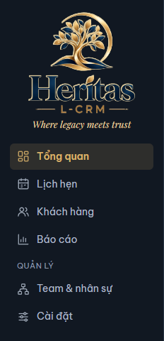

# 1. Bắt đầu

[← Mục lục](README.md)

## Chạy app (bản exe)

1. Chép file exe Project-2C vào một thư mục bạn có quyền ghi, ví dụ `D:\Apps\Project-2C\`. Không cần cài đặt.
2. Bấm đúp file exe. Lúc mở, app hiện "Đang mở dữ liệu…" rồi vào màn **Tổng quan**.

Mỗi thư mục dữ liệu chỉ mở được bằng một cửa sổ app tại một lúc. Bấm mở exe lần nữa khi app đang chạy, cửa sổ mới báo "Project-2C đang mở ở một cửa sổ khác" và không đọc, không ghi gì: hãy dùng cửa sổ đang mở và đóng cửa sổ mới.

## Thư mục `Project2C-data\` (bản exe)

App tạo thư mục `Project2C-data\` ngay cạnh file exe:

| Trong thư mục | Là gì |
|---|---|
| `project2c.db` | File dữ liệu: mọi KH, lịch hẹn, HĐ, nhân sự, ghi chú KYC, phân tích AI, cài đặt AI |
| `backups\` | Bản sao lưu tự động: app chép file dữ liệu vào đây **mỗi lần mở app**, giữ 10 bản mới nhất. Trước khi nhập backup hay nạp lại dữ liệu giả lập, app cũng sao lưu vào đây |
| `exports\` | File bạn xuất ra: backup `.p2cbackup` (Cài đặt → Dữ liệu → **Xuất backup**) và báo cáo Excel (Báo cáo → **Xuất Excel**) |

Muốn mang app sang ổ khác hay máy khác, chép cả file exe lẫn thư mục `Project2C-data\` (khi app đã đóng). Đường dẫn và lần lưu cuối xem ở **Cài đặt → Dữ liệu**, mục "File dữ liệu".

API key OpenCode **không** nằm trong thư mục này: key lưu trong Windows Credential Manager của từng máy.

## Lần mở đầu: dữ liệu giả lập

Khi chưa có file dữ liệu, app tự tạo **dữ liệu giả lập**: 3 team × 10 RE, KH, lịch hẹn và HĐ khoảng 12 tháng tính tới hôm nay. Dữ liệu này để làm quen và thử app; tên người, số liệu đều là giả.

Muốn bắt đầu lại từ dữ liệu giả lập mới: **Cài đặt → Dữ liệu → Nạp lại…** (xem [9. Cài đặt](09-cai-dat.md#nạp-lại-dữ-liệu-giả-lập)).

Bản web không có thư mục này: dữ liệu chỉ nằm trong trình duyệt, mỗi lần tải lại trang là một bộ dữ liệu giả lập mới.

## App tự lưu

Không có nút Lưu chung. Mỗi lần bạn bấm lưu trong một hộp (Lưu KH, Lưu kết quả, Lưu HĐ…), thay đổi được ghi ngay vào file dữ liệu. Thời điểm lưu gần nhất hiện ở **Cài đặt → Dữ liệu**, dòng "Lưu lần cuối".

### Khi app chưa lưu được (bản exe)

Nếu file dữ liệu đang bị chương trình khác giữ (phần mềm diệt virus, đồng bộ đám mây…), một dải cảnh báo hiện ở đầu màn:

> Chưa lưu được dữ liệu vào file (file có thể đang mở trong chương trình khác). Dữ liệu vẫn còn trong app và sẽ được lưu lại ở lần thay đổi tiếp theo.

Bạn vẫn làm tiếp được; app thử lưu lại ở lần thay đổi sau và dải cảnh báo tự mất khi lưu được.

Nếu bạn đóng app lúc còn thay đổi chưa lưu, app hiện hộp **"Chưa lưu được thay đổi"**:

- Đóng chương trình đang giữ file rồi bấm **Thử lại**: app lưu rồi mới đóng (nếu vẫn chưa lưu được, hộp hiện lại).
- **Đóng và bỏ thay đổi chưa lưu**: đóng app, các thay đổi chưa ghi vào file sẽ mất.

Các lỗi khác lúc mở app xem ở [10. Khi có lỗi](10-su-co.md#lỗi-lúc-mở-app-bản-exe).

## Sidebar và góc nhìn

Sidebar bên trái mở các màn: **Tổng quan**, **Lịch hẹn**, **Khách hàng**, **Báo cáo**; nhóm **Quản lý** có **Team & nhân sự** và **Cài đặt**. Hồ sơ một KH mở từ màn Khách hàng hoặc từ lịch hẹn.

Ở góc trên bên phải các màn Tổng quan, Lịch hẹn, Khách hàng và Báo cáo có ô **Góc nhìn**:

| Góc nhìn | Xem gì |
|---|---|
| **Toàn bộ** | Mọi team, mọi RE |
| **Team** | Một team: chọn team ở ô bên cạnh. Ở Tổng quan, Team hiện mọi team cạnh nhau (không chọn một team) |
| **RE** | Một RE: chọn RE ở ô bên cạnh |

Góc nhìn là cách xem dữ liệu, không phải tài khoản đăng nhập: ai dùng app cũng xem và sửa được mọi dữ liệu. Góc nhìn chọn ở một màn giữ nguyên khi chuyển sang màn khác.

Ở Lịch hẹn và Khách hàng, khi góc nhìn là Team, phía trên có hàng RE của team (kèm số đếm). Bấm một RE để chỉ xem RE đó, bấm lại để bỏ; **Cả team** xem cả team.

[Mục kế tiếp: 2. Tổng quan →](02-tong-quan.md)
