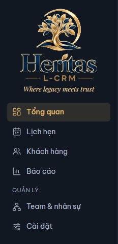

# 1. Bắt đầu

[← Mục lục](README.md)

Heritas L-CRM chạy trên Windows và macOS (bản máy tính), cùng giao diện và cùng file backup. Trên Windows có bản cài và chế độ portable; trên macOS là app cài từ file `.dmg`. Bản web để thử app ghi ở [Mục lục](README.md#bản-máy-tính-và-bản-web).

## Cài trên Windows

### Bản cài

1. Tải file cài `Heritas L-CRM_<phiên bản>_x64-setup.exe`, ví dụ `Heritas L-CRM_1.0.0_x64-setup.exe`.
2. Đóng mọi cửa sổ Heritas L-CRM đang mở, kể cả exe chạy thẳng của [chế độ portable](#chế-độ-portable) (xem [Khi trình cài báo app đang chạy](#khi-trình-cài-báo-app-đang-chạy)).
3. Bấm đúp file cài. File chưa ký nên SmartScreen có thể chặn lần mở đầu: bấm *More info* (thêm thông tin) rồi *Run anyway* (vẫn chạy).
4. Làm theo các màn của trình cài. Trình cài chỉ có tiếng Anh. Cài không cần quyền quản trị (không có hộp hỏi quyền admin): app cài cho người dùng Windows đang đăng nhập, mặc định vào `%LOCALAPPDATA%\Heritas L-CRM\`. Màn cuối có ô `Create desktop shortcut` (tạo thêm lối tắt trên màn hình nền).
5. Mở app từ lối tắt **Heritas L-CRM** ở menu Start.

Dữ liệu của bản cài nằm ở `%LOCALAPPDATA%\com.heritas.lcrm\`, khác thư mục cài app (xem [Nơi để dữ liệu](#nơi-để-dữ-liệu-bản-máy-tính)).

### Gỡ cài

1. Đóng mọi cửa sổ Heritas L-CRM, kể cả exe chạy thẳng.
2. Gỡ ở Cài đặt → Ứng dụng của Windows, dòng **Heritas L-CRM**.
3. Trình gỡ (tiếng Anh) có ô `Delete the application data` (xóa dữ liệu của app), mặc định không tích:
   - Không tích (nên dùng): gỡ app, giữ nguyên thư mục dữ liệu `%LOCALAPPDATA%\com.heritas.lcrm\`. Cài lại là thấy dữ liệu cũ.
   - Tích: xóa luôn cả thư mục dữ liệu đó: file dữ liệu, các bản sao lưu tự động trong `backups`, mọi file đã xuất trong `exports` (backup `.p2cbackup`, báo cáo Excel) và bộ nhớ giao diện (`EBWebView`). Không lấy lại được. Chỉ tích khi chắc không cần dữ liệu nữa; muốn giữ thì trước đó **Xuất backup** và chép file `.p2cbackup` ra ngoài thư mục này.

Gỡ cài không đụng thư mục `Project2C-data\` của chế độ portable.

### Chế độ portable

Chế độ portable dùng file `project2c.exe` chạy thẳng, không qua trình cài, và để dữ liệu ngay cạnh exe: tiện để thử app ở một thư mục riêng hay chạy từ USB. Bản phát hành chỉ có file cài; exe chạy thẳng đi kèm bản build của mỗi lần sửa app, dùng để thử và nghiệm thu.

1. Chép `project2c.exe` vào một thư mục bạn có quyền ghi, ví dụ `D:\Apps\Heritas\`.
2. Tạo một thư mục trống tên `Project2C-data` ngay cạnh exe, **trước** lần chạy đầu.
3. Bấm đúp exe. SmartScreen có thể hỏi như ở bản cài (*More info* → *Run anyway*). App ghi dữ liệu vào `Project2C-data\`.

Exe chạy thẳng mà **không có** thư mục `Project2C-data\` cạnh nó thì không tạo thư mục đó: exe mở dữ liệu của bản cài ở `%LOCALAPPDATA%\com.heritas.lcrm\`, như bản cài.

Muốn mang app sang ổ khác hay máy khác ở chế độ portable, chép cả `project2c.exe` lẫn thư mục `Project2C-data\` (khi app đã đóng).

### Khi trình cài báo app đang chạy

Trình cài và trình gỡ tìm mọi `project2c.exe` đang chạy của người dùng Windows, cả bản cài lẫn exe chạy thẳng, rồi hiện hộp `Heritas L-CRM is running!`, dòng dưới `Click OK to kill it`:

- Bấm nút hủy (*Cancel*), đóng app như thường (app lưu xong rồi mới đóng), rồi chạy lại file cài / trình gỡ.
- Bấm **OK** thì app bị tắt ngay, không qua bước lưu khi đóng: nếu app đang báo "Chưa lưu được dữ liệu vào file…", các thay đổi chỉ còn trong app sẽ mất.

## Cài trên macOS

Bản macOS chạy trên máy Mac chip Apple, macOS 26 trở lên.

### Mở file .dmg

1. Tải file `Heritas L-CRM_<phiên bản>_aarch64.dmg` (ví dụ bằng Safari).
2. Bấm đúp file `.dmg`. Cửa sổ mở ra có app **Heritas L-CRM** và lối tắt **Applications**.
3. Kéo app **Heritas L-CRM** vào lối tắt **Applications**.
4. Mở app từ thư mục Applications.

Bản mới: đóng app, tải `.dmg` mới và kéo app vào Applications như trên, đồng ý thay bản cũ. Dữ liệu ở `~/Library/Application Support/com.heritas.lcrm/` giữ nguyên.

### Lần mở đầu: Open Anyway

App chưa ký bằng Developer ID của Apple, nên macOS chặn lần mở đầu của mỗi bản app tải bằng trình duyệt. Từ macOS 15, chuột phải → Open không còn mở được app bị chặn; phải vào System Settings như dưới.

Hướng dẫn ghi tên mục và nút của macOS bằng tiếng Anh, đúng chữ trên màn của macOS 27.2 tiếng Anh; chữ trong ngoặc đơn chỉ là lời giải thích. Máy để tiếng Việt thì macOS ghi bằng tiếng Việt, chữ có thể khác lời giải thích ở đây.

1. Mở app lần đầu: macOS hiện hộp `“Heritas L-CRM” Not Opened` (chưa mở app), với câu `Apple could not verify “Heritas L-CRM” is free of malware that may harm your Mac or compromise your privacy.` Bấm `Done` (xong). **Không** bấm `Move to Trash` (chuyển app vào Thùng rác), dù đó là nút chính màu xanh.
2. Mở `System Settings` (Cài đặt hệ thống) → `Privacy & Security` (Quyền riêng tư & Bảo mật), kéo xuống nhóm `Security` (bảo mật), chỗ dòng `Allow applications from` (cho phép app từ đâu), đang chọn `App Store & Known Developers` (không cần đổi). Ở đó có dòng `“Heritas L-CRM” was blocked to protect your Mac.` (app bị chặn để bảo vệ máy) và nút `Open Anyway` (vẫn mở). Bấm `Open Anyway`.
3. macOS hỏi lại bằng hộp `Open “Heritas L-CRM”?` (mở app?), với câu `Apple is not able to verify that it is free from malware that could harm your Mac or compromise your privacy. Don’t open this unless you are certain it is from a trustworthy source.` Bấm `Open Anyway`. Nút chính của hộp này vẫn là `Move to Trash`: đừng bấm nút đó.
4. macOS xác nhận quyền bằng hộp `You are attempting to open an app that may cause harm to your Mac or compromise your privacy` (bạn đang mở một app có thể gây hại), với câu `Touch ID or enter an administrator’s name and password to continue with Privacy & Security.` Chạm Touch ID, hoặc bấm `Use Password...` (dùng mật khẩu) rồi nhập tên và mật khẩu quản trị của máy.
5. App mở. Từ lần sau, app mở như mọi app khác.

Nút `Open Anyway` chỉ hiện ở `Privacy & Security` khoảng một giờ sau lần mở bị chặn. Không thấy nút thì mở app lại (macOS chặn lại, bấm `Done`) rồi làm lại từ bước 2.

### Keychain hỏi mật khẩu sau mỗi bản mới

Trên macOS, API key OpenCode nằm trong Keychain đăng nhập (login) của máy, mục `Project-2C` (xem [9. Cài đặt](09-cai-dat.md#api-key-opencode-bản-máy-tính)). App chưa ký bằng Developer ID, nên với Keychain mỗi bản app mới là một app khác.

Lần đầu một bản app mới đọc key đã lưu (mở Cài đặt → AI, Phân tích, AI trích xuất hay Kiểm tra kết nối), macOS hiện hộp hỏi mật khẩu đăng nhập của máy để cho app dùng mục key đó:

- Nhập mật khẩu và chọn nút luôn cho phép: macOS không hỏi lại tới bản app sau.
- Nút chỉ cho phép lần này: macOS hỏi lại ở lần app đọc key sau.
- Từ chối: app báo lỗi kho key (xem [10. Khi có lỗi](10-su-co.md#lỗi-ai-thường-gặp)).

## Mở app (bản máy tính)

Lúc mở, app hiện "Đang mở dữ liệu…" rồi vào màn bạn dùng lần cuối. Lần mở đầu tiên trên một máy, app vào màn **Tổng quan**.

App nhớ màn dùng lần cuối theo người dùng của máy, không theo thư mục dữ liệu. Trên Windows, bản cài và mọi exe chạy thẳng của cùng người dùng dùng chung: mở một exe ở thư mục khác (kể cả lần mở đầu của thư mục đó), app cũng vào màn dùng lần cuối của bản trước.

Mỗi thư mục dữ liệu chỉ mở được bằng một cửa sổ app tại một lúc. Một cửa sổ app thứ hai mở cùng thư mục dữ liệu (ví dụ bản cài đang chạy mà bạn mở thêm một exe chạy thẳng không có `Project2C-data\` cạnh nó) báo "Project-2C đang mở ở một cửa sổ khác" và không đọc, không ghi gì: hãy dùng cửa sổ đang mở và đóng cửa sổ mới.

## Nơi để dữ liệu (bản máy tính)

Thư mục dữ liệu theo nền tảng và chế độ:

| Bản | Thư mục dữ liệu |
|---|---|
| Windows, bản cài | `%LOCALAPPDATA%\com.heritas.lcrm\`, tức `C:\Users\<tên người dùng>\AppData\Local\com.heritas.lcrm\` |
| Windows, chế độ portable | `Project2C-data\` ngay cạnh `project2c.exe` (xem [Chế độ portable](#chế-độ-portable)) |
| macOS | `~/Library/Application Support/com.heritas.lcrm/`, tức `/Users/<tên người dùng>/Library/Application Support/com.heritas.lcrm/` |

Đường dẫn thật của máy đang dùng xem ở **Cài đặt → Dữ liệu**, dòng **Vị trí** (file dữ liệu) và **Backup tự động** (thư mục `backups`). Nút **Mở thư mục** ở dòng Backup tự động mở thư mục đó trong File Explorer (Windows) hay Finder (macOS). Trên macOS, Finder ẩn thư mục `Library`: trong Finder bấm ⇧⌘G (đi tới thư mục) rồi dán đường dẫn.

| Trong thư mục | Là gì |
|---|---|
| `project2c.db` | File dữ liệu: mọi KH, lịch hẹn, HĐ, nhân sự, ghi chú KYC, phân tích AI, cài đặt AI |
| `backups` | Bản sao lưu tự động: app chép file dữ liệu vào đây **mỗi lần mở app**, giữ 10 bản mới nhất. Trước khi nhập backup, nạp lại dữ liệu giả lập hay dọn sạch Thùng rác, app cũng sao lưu vào đây |
| `exports` | File bạn xuất ra: backup `.p2cbackup` (Cài đặt → Dữ liệu → **Xuất backup**) và báo cáo Excel (Báo cáo → **Xuất Excel**) |

Thư mục của bản cài Windows còn có `EBWebView`: bộ nhớ của khung hiện giao diện (màn dùng lần cuối), chung cho bản cài và exe chạy thẳng.

Muốn chuyển dữ liệu sang máy khác, kể cả giữa Windows và macOS, dùng file backup (xem [Làm trên hai máy](README.md#làm-trên-hai-máy)).

API key OpenCode **không** nằm trong thư mục dữ liệu: key lưu trong kho key của hệ điều hành trên từng máy, Windows Credential Manager (Windows) hay Keychain (macOS).

## Phím tắt trên Windows và macOS

- Trên macOS, phím ⌘ (Command) thay Ctrl: chọn hết, copy, dán là ⌘A, ⌘C, ⌘V; trên Windows là Ctrl+A, Ctrl+C, Ctrl+V. Câu trong app ghi phím theo nền tảng đang chạy.
- Bản máy tính không tải lại trang và không lùi / tiến màn như trình duyệt, để không mất việc đang làm dở. Các phím đó không làm gì: Windows F5, Ctrl+R, Alt+← / Alt+→; macOS ⌘R, ⌘[ / ⌘], và ⌘← / ⌘→ ngoài ô chữ (trong ô chữ, ⌘← / ⌘→ đưa con trỏ về đầu / cuối dòng).

## Lần mở đầu: dữ liệu giả lập

Khi chưa có file dữ liệu, app tự tạo **dữ liệu giả lập**: 3 team × 10 RM, KH, lịch hẹn và HĐ khoảng 12 tháng tính tới hôm nay. Dữ liệu này để làm quen và thử app; tên người, số liệu đều là giả.

Muốn bắt đầu lại từ dữ liệu giả lập mới: **Cài đặt → Dữ liệu → Nạp lại…** (xem [9. Cài đặt](09-cai-dat.md#nạp-lại-dữ-liệu-giả-lập)).

Bản web không có thư mục dữ liệu: dữ liệu chỉ nằm trong trình duyệt, mỗi lần tải lại trang là một bộ dữ liệu giả lập mới.

## App tự lưu

Không có nút Lưu chung. Mỗi lần bạn bấm lưu trong một hộp (Lưu KH, Lưu kết quả, Lưu HĐ…), thay đổi được ghi ngay vào file dữ liệu.

Chân sidebar, ở mọi màn, cho biết trạng thái lưu (bản máy tính):

| Chỉ báo | Nghĩa |
|---|---|
| **Đã lưu 07:42** (chấm xanh) | Mọi thay đổi đã nằm trong file; giờ là lần lưu gần nhất. Mới mở app, chưa thay đổi gì thì chỉ ghi **Đã lưu**: file đúng là dữ liệu đang hiện |
| **Đang lưu…** (chấm xám) | App đang ghi vào file, hoặc đang nạp lại dữ liệu giả lập, nhập backup hay dọn sạch Thùng rác |
| **Chưa lưu được vào file** (chữ đỏ) | Lần lưu gần nhất bị lỗi, xem [Khi app chưa lưu được](#khi-app-chưa-lưu-được-bản-máy-tính) |

Bản web ghi "Bản web — dữ liệu chỉ trong trình duyệt, mất khi tải lại trang". Giờ và cỡ file của lần lưu gần nhất cũng hiện ở **Cài đặt → Dữ liệu**, dòng "Lưu lần cuối".

Đóng app lúc sidebar ghi "Đang lưu…" thì app chờ lưu xong rồi mới đóng, kể cả khi đang nạp lại, nhập backup hay dọn sạch Thùng rác: dữ liệu mới vào file đủ.

### Khi app chưa lưu được (bản máy tính)

Nếu file dữ liệu đang bị chương trình khác giữ (phần mềm diệt virus, đồng bộ đám mây…), một dải cảnh báo hiện ở đầu màn:

> Chưa lưu được dữ liệu vào file (file có thể đang mở trong chương trình khác). Dữ liệu vẫn còn trong app và sẽ được lưu lại ở lần thay đổi tiếp theo.

Nếu ổ đĩa chứa thư mục dữ liệu đã đầy, dải cảnh báo ghi:

> Chưa lưu được dữ liệu vào file: ổ đĩa chứa thư mục dữ liệu đã đầy. Hãy xóa bớt file trên ổ đó (ví dụ các file cũ trong thư mục exports của thư mục dữ liệu, đường dẫn ở Cài đặt → Dữ liệu). Dữ liệu vẫn còn trong app và sẽ được lưu lại ở lần thay đổi tiếp theo.

Nếu file `project2c.db` chuyển sang chỉ đọc hay bị khóa lúc app đang chạy, hoặc tài khoản người dùng của máy không còn quyền ghi / xóa file đó, dải cảnh báo ghi:

> Chưa lưu được dữ liệu vào file: file dữ liệu (Cài đặt → Dữ liệu → Vị trí) đang ở chế độ chỉ đọc hay bị khóa, hoặc tài khoản người dùng của máy đang dùng không có quyền ghi / xóa file đó. Hãy bỏ chế độ chỉ đọc (Windows: chuột phải file → Properties → bỏ chọn Read-only; macOS: chọn file trong Finder → Get Info → bỏ chọn Locked, cho quyền Read & Write) hoặc nhờ người quản trị máy cấp lại quyền. Dữ liệu vẫn còn trong app và sẽ được lưu lại ở lần thay đổi tiếp theo.

Nếu thư mục dữ liệu không còn cho tài khoản người dùng của máy tạo file mới trong đó (mỗi lần lưu, app ghi một file mới rồi mới thay file cũ), dải cảnh báo ghi:

> Chưa lưu được dữ liệu vào file: thư mục dữ liệu (đường dẫn ở Cài đặt → Dữ liệu) không cho tài khoản người dùng của máy đang dùng tạo file mới trong đó. Hãy nhờ người quản trị máy cấp lại quyền ghi vào thư mục đó. Dữ liệu vẫn còn trong app và sẽ được lưu lại ở lần thay đổi tiếp theo.

Bạn vẫn làm tiếp được; app thử lưu lại ở lần thay đổi sau và dải cảnh báo tự mất khi lưu được. Xử lý xong nguyên nhân thì bấm **Thử lại** ở cuối dải để lưu ngay: lưu được thì dải mất và sidebar ghi "Đã lưu …"; vẫn lỗi thì dải ở lại, câu theo nguyên nhân của lần thử này.

Trong lúc lần lưu gần nhất còn lỗi, app không nhập backup, không nạp lại dữ liệu giả lập và không dọn sạch Thùng rác, vì bản backup làm trước đó sẽ thiếu các thay đổi chưa lưu. Câu báo chỉ tới nút **Thử lại**: lưu được rồi thì làm lại.

Nếu bạn đóng app lúc còn thay đổi chưa lưu được, app hiện hộp **"Chưa lưu được thay đổi"**, với câu theo nguyên nhân như ở dải cảnh báo:

- Xử lý nguyên nhân rồi bấm **Thử lại**: đóng chương trình đang giữ file, hoặc xóa bớt file trên ổ đầy, hoặc bỏ chế độ chỉ đọc / bỏ khóa / cấp lại quyền cho file hay thư mục. App lưu rồi mới đóng (nếu vẫn chưa lưu được, hộp hiện lại).
- **Đóng và bỏ thay đổi chưa lưu**: đóng app, các thay đổi chưa ghi vào file sẽ mất.

Các lỗi khác lúc mở app xem ở [10. Khi có lỗi](10-su-co.md#lỗi-lúc-mở-app-bản-máy-tính).

## Sidebar và góc nhìn

Góc trên sidebar là logo Heritas L-CRM và slogan "Where legacy meets trust". Sidebar bên trái mở các màn: **Tổng quan**, **Lịch hẹn**, **Khách hàng**, **Báo cáo**; nhóm **Quản lý** có **Team & nhân sự** và **Cài đặt**. Hồ sơ một KH mở từ màn Khách hàng hoặc từ lịch hẹn. Thanh tiêu đề cửa sổ ghi màn đang mở, ví dụ "Khách hàng · Heritas L-CRM".

Ở góc trên bên phải các màn Tổng quan, Lịch hẹn, Khách hàng và Báo cáo có ô **Góc nhìn**:

| Góc nhìn | Xem gì |
|---|---|
| **Toàn bộ** | Mọi team, mọi RM |
| **Team** | Một team: chọn team ở ô bên cạnh. Ở Tổng quan, Team hiện mọi team cạnh nhau (không chọn một team) |
| **RM** | Một RM: chọn RM ở ô bên cạnh |

Góc nhìn là cách xem dữ liệu, không phải tài khoản đăng nhập: ai dùng app cũng xem và sửa được mọi dữ liệu. Góc nhìn chọn ở một màn giữ nguyên khi chuyển sang màn khác.

Ở Lịch hẹn và Khách hàng, khi góc nhìn là Team, phía trên có hàng RM của team (kèm số đếm). Bấm một RM để chỉ xem RM đó, bấm lại để bỏ; **Cả team** xem cả team.

[Mục kế tiếp: 2. Tổng quan →](02-tong-quan.md)
