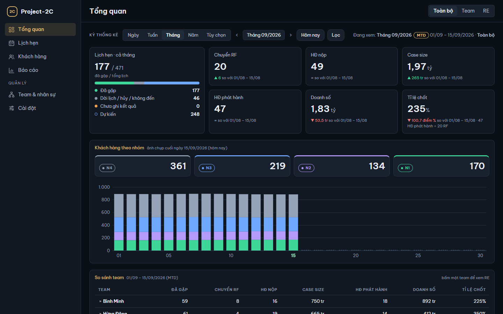
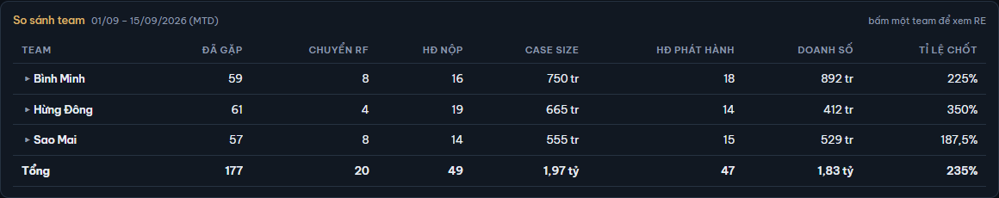

# 2. Tổng quan

[← Mục lục](README.md)

Màn này cho biết số lịch hẹn, Doanh số và 6 chỉ số chính, KH theo nhóm và so sánh giữa các team của một kỳ. Lần mở app đầu tiên trên một máy vào màn này; các lần sau app mở lại màn dùng lần cuối (xem [1. Bắt đầu](01-bat-dau.md#mở-app-bản-máy-tính)).

Màn này không ghi tên KH, nên khi đang [che tên KH](01-bat-dau.md#che-tên-kh-khi-chiếu-màn-hình) mọi ô, bảng và chart vẫn như khi không che.

## Chọn kỳ và góc nhìn

Viên **kỳ** trên thanh công cụ, cạnh viên góc nhìn, ghi kỳ đang xem (lúc mở màn là tháng hiện tại):

1. Dùng hai nút mũi tên ‹ › (**Kỳ trước** / **Kỳ sau**) ở hai đầu viên để lùi / tiến một kỳ.
2. Bấm tên kỳ ở giữa viên để mở bảng **Chọn kỳ**. Chọn loại kỳ: **Ngày**, **Tuần** (Thứ Hai → Chủ nhật), **Tháng**, **Năm** hoặc **Tùy chọn**. Đổi loại kỳ giữ ngày đang xem: đang ở tháng có hôm nay, chọn **Tuần** là ra tuần này.
3. Với **Tùy chọn**: gõ **Từ ngày** và **Đến ngày** dạng dd/mm/yyyy. Khoảng ngày được nhận khi bấm Enter hoặc khi rời cả hai ô; Tab từ ô này sang ô kia chưa báo lỗi. Kỳ Tùy chọn dài tối đa 3 tháng.
4. **Hôm nay** trong bảng đưa về kỳ chứa hôm nay và đóng bảng. Đóng bảng: bấm ra ngoài hoặc nhấn Esc.
5. Chọn góc nhìn ở viên **góc nhìn** bên cạnh (xem [1. Bắt đầu](01-bat-dau.md#sidebar-và-góc-nhìn)).

Đổi kỳ hay góc nhìn là số trên màn đổi ngay, không có nút nào phải bấm thêm.

Dòng dưới tên màn cho biết số trên màn thuộc kỳ và góc nhìn nào, ví dụ "Tháng 09/2026 · 01/09 – 15/09/2026 (MTD) · Toàn bộ". Tháng đang diễn ra có chữ **(MTD)** (từ ngày 1 tới hôm nay) sau khoảng ngày được tính; năm đang diễn ra cũng ghi khoảng ngày được tính.

Ở Tổng quan, góc nhìn **Mọi team** cộng mọi team và vẽ mỗi team một biểu đồ; muốn xem một team riêng, dùng màn Báo cáo hoặc góc nhìn RM.

## Ô Lịch hẹn

Ô bên trái (ví dụ "Lịch hẹn · cả tháng") đếm **mọi lịch hẹn trong cả kỳ**, kể cả lịch sau hôm nay. Số lớn là "đã gặp / tổng lịch". Bên dưới chia 4 nhóm:

| Nhóm | Gồm |
|---|---|
| **Đã gặp** | Lịch đã ghi kết quả Đã gặp |
| **Dời lịch / hủy / không đến** | Lịch đã dời, KH hủy hoặc không đến |
| **Chưa ghi kết quả** | Lịch còn Dự kiến mà ngày hẹn **trước** hôm nay: cần ghi kết quả (xem [3. Lịch hẹn](03-lich-hen.md#ghi-kết-quả-cuộc-gặp)) |
| **Dự kiến** | Lịch từ hôm nay trở đi, chưa có kết quả |

Một lịch dời là hai bản ghi: lịch cũ tính ở nhóm Dời lịch, lịch mới tính ở ngày mới.

## Doanh số và 6 chỉ số của kỳ

Ô **Doanh số** nằm trên cùng, rồi tới 6 ô chỉ số. Dưới mỗi số là một dòng nhỏ ghi phép tính của số đó, hoặc số đó đếm gì:

| Ô | Nghĩa | Dòng nhỏ, ví dụ |
|---|---|---|
| **Doanh số** | FYP phát hành − FYP hủy trong kỳ; có thể âm | "FYP phát hành 1.38 tỷ − FYP hủy 50 tr" |
| **Tổng số HĐ** | HĐ phát hành − HĐ hủy trong kỳ; có thể âm | "33 phát hành − 1 hủy" |
| **Tỷ lệ hủy** | HĐ hủy ÷ HĐ phát hành trong cùng kỳ; có thể vượt 100%. Kỳ không có HĐ phát hành thì hiện "—" | "1 hủy ÷ 33 phát hành" |
| **Tỷ lệ chốt** | HĐ phát hành ÷ Chuyển RF trong cùng kỳ, không trừ HĐ hủy. Kỳ không có RF thì hiện "—" | "33 HĐ phát hành ÷ 25 RF" |
| **Chuyển RF** | Số cuộc gặp đưa KH từ N4 / N3 lên N2 / N1, tính vào ngày gặp | "từ 40 buổi đã gặp" |
| **HĐ nộp** | Số HĐ có ngày nộp trong kỳ | "HĐ có ngày nộp trong kỳ" |
| **Case size** | Tổng FYP nộp của các HĐ nộp trong kỳ | "FYP nộp của 12 HĐ" |

HĐ hủy tính vào kỳ chứa **ngày hủy**, không phải kỳ phát hành. Vì vậy một kỳ ngắn có thể ra Tổng số HĐ hay Doanh số âm (ghi "-1", "-50 tr", chữ đỏ), hoặc Tỷ lệ hủy trên 100%. Tỷ lệ "—" vẫn có dòng phép chia (ví dụ "1 hủy ÷ 0 phát hành") để thấy vì sao.

Với kỳ chưa hết, các chỉ số tính **tới hôm nay**.

Dòng nhỏ cuối mỗi ô so với kỳ trước, **cùng số ngày**: ví dụ hôm nay 15/09, Tháng 09 (MTD) so với 01/08 – 15/08. ▲ là tăng, ▼ là giảm, "=" là bằng; chữ xanh là tốt hơn, chữ đỏ là kém đi, nên **Tỷ lệ hủy tăng là đỏ**. Hai tỷ lệ so bằng **điểm %**. Không so khi kỳ là Tùy chọn, kỳ chưa bắt đầu, hoặc khi một tỷ lệ không có số để chia ở kỳ này hay kỳ trước (0 RF với Tỷ lệ chốt, 0 HĐ phát hành với Tỷ lệ hủy): dòng nhỏ ghi "không so".

Bấm một ô để mở [Báo cáo](07-bao-cao.md) ở cùng kỳ và góc nhìn. Riêng góc nhìn **Mọi team**: Báo cáo không có góc nhìn này, nên mở ở một team (team chọn lần trước ở màn khác, chưa chọn thì team đầu tiên); chọn **Toàn bộ** ở Báo cáo để xem mọi team cạnh nhau.

Định nghĩa đầy đủ các chỉ số ở [11. Thuật ngữ](11-thuat-ngu.md#hợp-đồng-và-chỉ-số).

## Khách hàng theo nhóm

Bốn ô **N4**, **N3**, **N2**, **N1** đếm số KH ở mỗi nhóm vào **cuối ngày cuối kỳ** (kỳ chưa hết: hôm nay), ghi rõ "ảnh chụp cuối ngày …". KH đã đóng (Tạm hoãn, Mất cơ hội) không nằm trong 4 ô; xem ở màn Khách hàng hoặc Báo cáo.

Biểu đồ cột bên dưới cho thấy diễn biến: mỗi cột là ảnh chụp cuối một ngày (kỳ Tuần, Tháng) hoặc cuối một tháng (kỳ Năm); cột sau hôm nay để trống.

Bấm một ô nhóm để ẩn nhóm đó khỏi biểu đồ (ô ghi "đang ẩn"); bấm lại để hiện.

Trình đọc màn hình (ví dụ Narrator) đọc được số của biểu đồ. Tới biểu đồ, nó đọc số của mốc cuối có số liệu (thường là hôm nay). Ngay sau biểu đồ là bảng số đi kèm, không hiện trên màn: mỗi cột là một dòng, gồm các nhóm đang hiện và **Tổng**, như khi rê chuột lên cột.

## So sánh team

Bảng **So sánh team** (góc nhìn Toàn bộ và Mọi team) đặt các team cạnh nhau: Đã gặp, Chuyển RF, HĐ nộp, Case size, HĐ phát hành, Doanh số, Tỷ lệ chốt; dòng **Tổng** cộng mọi team (Tỷ lệ chốt dòng Tổng = tổng HĐ phát hành ÷ tổng RF, không lấy trung bình).

Bấm một team để xem các RM của team ngay bên dưới; bấm lại để thu. Bảng không so với kỳ trước. Góc nhìn RM không có bảng này.

[← 1. Bắt đầu](01-bat-dau.md) · [3. Lịch hẹn →](03-lich-hen.md)
