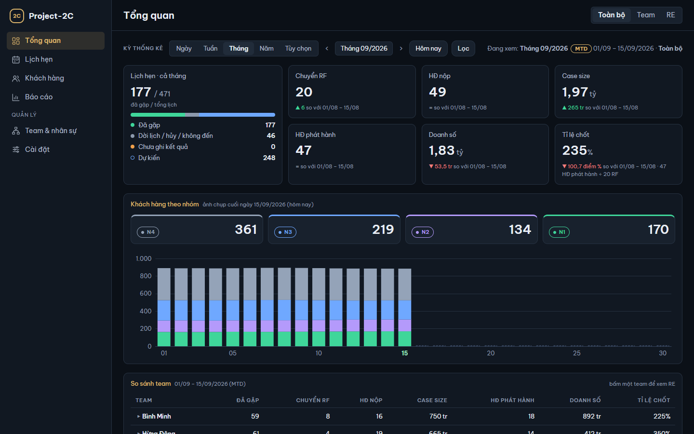
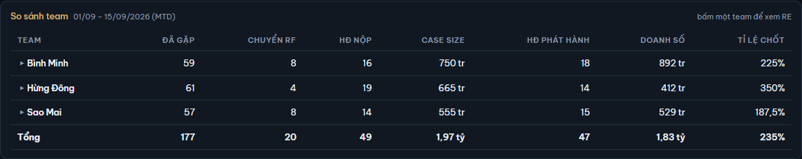

# 2. Tổng quan

[← Mục lục](README.md)

Màn đầu tiên khi mở app: số lịch hẹn, 6 chỉ số chính, KH theo nhóm và so sánh giữa các team của một kỳ.

## Chọn kỳ và bấm Lọc

Hàng **Kỳ thống kê** ở đầu màn:

1. Chọn loại kỳ: **Ngày**, **Tuần** (Thứ Hai → Chủ nhật), **Tháng**, **Năm** hoặc **Tùy chọn**.
2. Dùng hai nút mũi tên (**Kỳ trước** / **Kỳ sau**) để lùi / tiến một kỳ; **Hôm nay** về kỳ chứa hôm nay.
3. Với **Tùy chọn**: gõ **Từ ngày** và **Đến ngày** dạng dd/mm/yyyy. Khoảng ngày được nhận khi bấm Enter hoặc khi rời cả hai ô; Tab từ ô này sang ô kia chưa báo lỗi. Kỳ Tùy chọn dài tối đa 3 tháng.
4. Chọn **Góc nhìn** ở góc trên bên phải (xem [1. Bắt đầu](01-bat-dau.md#sidebar-và-góc-nhìn)).
5. Bấm **Lọc**. Số liệu chỉ đổi khi bấm Lọc; trước đó màn nhắc "Đã đổi kỳ / góc nhìn — bấm Lọc để cập nhật".

Dòng **Đang xem:** bên phải cho biết số trên màn thuộc kỳ và góc nhìn nào. Tháng đang diễn ra có nhãn **MTD** (từ ngày 1 tới hôm nay), kèm khoảng ngày được tính.

Ở Tổng quan, góc nhìn **Team** cộng mọi team và vẽ mỗi team một biểu đồ; muốn xem một team riêng, dùng màn Báo cáo hoặc góc nhìn RE.

## Ô Lịch hẹn

Ô bên trái (ví dụ "Lịch hẹn · cả tháng") đếm **mọi lịch hẹn trong cả kỳ**, kể cả lịch sau hôm nay. Số lớn là "đã gặp / tổng lịch". Bên dưới chia 4 nhóm:

| Nhóm | Gồm |
|---|---|
| **Đã gặp** | Lịch đã ghi kết quả Đã gặp |
| **Dời lịch / hủy / không đến** | Lịch đã dời, KH hủy hoặc không đến |
| **Chưa ghi kết quả** | Lịch còn Dự kiến mà ngày hẹn **trước** hôm nay: cần ghi kết quả (xem [3. Lịch hẹn](03-lich-hen.md#ghi-kết-quả-cuộc-gặp)) |
| **Dự kiến** | Lịch từ hôm nay trở đi, chưa có kết quả |

Một lịch dời là hai bản ghi: lịch cũ tính ở nhóm Dời lịch, lịch mới tính ở ngày mới.

## 6 chỉ số của kỳ

| Ô | Nghĩa |
|---|---|
| **Chuyển RF** | Số cuộc gặp đưa KH từ N4 / N3 lên N2 / N1, tính vào ngày gặp |
| **HĐ nộp** | Số HĐ có ngày nộp trong kỳ |
| **Case size** | Tổng FYP nộp của các HĐ nộp trong kỳ |
| **HĐ phát hành** | Số HĐ có ngày phát hành trong kỳ |
| **Doanh số** | Tổng FYP phát hành của các HĐ phát hành trong kỳ |
| **Tỉ lệ chốt** | HĐ phát hành ÷ Chuyển RF trong cùng kỳ (dòng nhỏ ghi phép chia). Kỳ không có RF thì hiện "—" |

Với kỳ chưa hết, 6 chỉ số tính **tới hôm nay**.

Dòng nhỏ dưới mỗi số so với kỳ trước, **cùng số ngày**: ví dụ hôm nay 15/09, Tháng 09 (MTD) so với 01/08 – 15/08. ▲ là tăng, ▼ là giảm, "=" là bằng; Tỉ lệ chốt so bằng **điểm %**. Không so khi kỳ là Tùy chọn, kỳ chưa bắt đầu, hoặc kỳ trước có 0 RF (Tỉ lệ chốt).

Định nghĩa đầy đủ các chỉ số ở [11. Thuật ngữ](11-thuat-ngu.md#hợp-đồng-và-chỉ-số).

## Khách hàng theo nhóm

Bốn ô **N4**, **N3**, **N2**, **N1** đếm số KH ở mỗi nhóm vào **cuối ngày cuối kỳ** (kỳ chưa hết: hôm nay), ghi rõ "ảnh chụp cuối ngày …". KH đã đóng (Tạm hoãn, Mất cơ hội) không nằm trong 4 ô; xem ở màn Khách hàng hoặc Báo cáo.

Biểu đồ cột bên dưới cho thấy diễn biến: mỗi cột là ảnh chụp cuối một ngày (kỳ Tuần, Tháng) hoặc cuối một tháng (kỳ Năm); cột sau hôm nay để trống.

Bấm một ô nhóm để ẩn nhóm đó khỏi biểu đồ (ô ghi "đang ẩn"); bấm lại để hiện.

Trình đọc màn hình (ví dụ Narrator) đọc được số của biểu đồ. Tới biểu đồ, nó đọc số của mốc cuối có số liệu (thường là hôm nay). Ngay sau biểu đồ là bảng số đi kèm, không hiện trên màn: mỗi cột là một dòng, gồm các nhóm đang hiện và **Tổng**, như khi rê chuột lên cột.

## So sánh team

Bảng **So sánh team** (góc nhìn Toàn bộ và Team) đặt các team cạnh nhau: Đã gặp, Chuyển RF, HĐ nộp, Case size, HĐ phát hành, Doanh số, Tỉ lệ chốt; dòng **Tổng** cộng mọi team (Tỉ lệ chốt dòng Tổng = tổng HĐ phát hành ÷ tổng RF, không lấy trung bình).

Bấm một team để xem các RE của team ngay bên dưới; bấm lại để thu. Bảng không so với kỳ trước. Góc nhìn RE không có bảng này.

[← 1. Bắt đầu](01-bat-dau.md) · [3. Lịch hẹn →](03-lich-hen.md)
