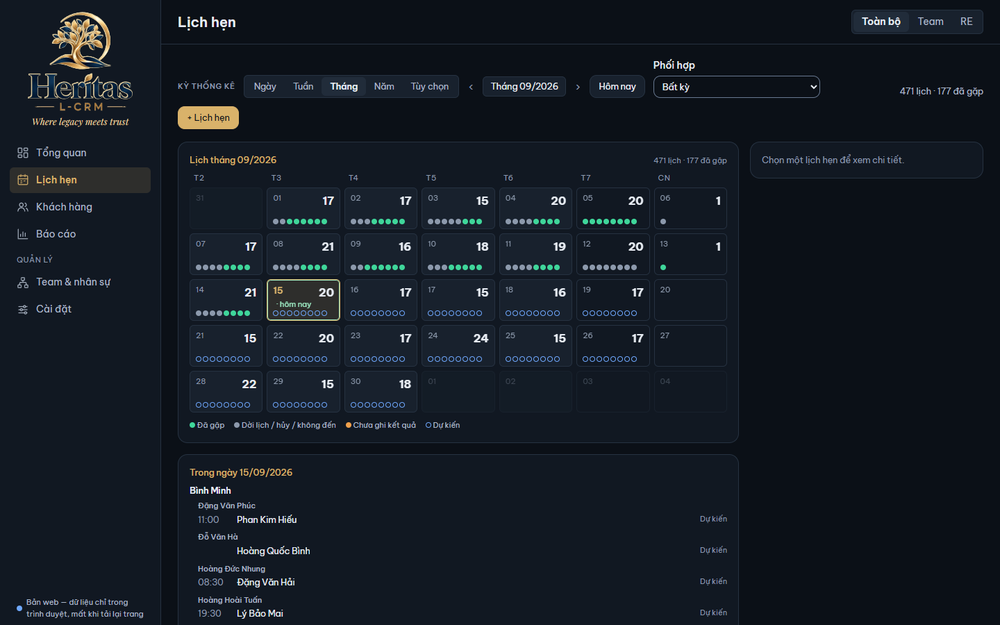
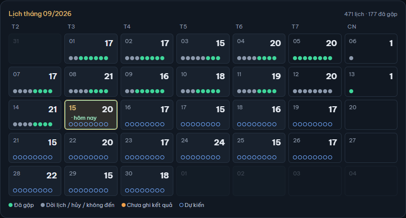
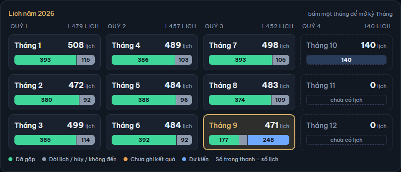
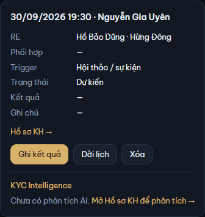
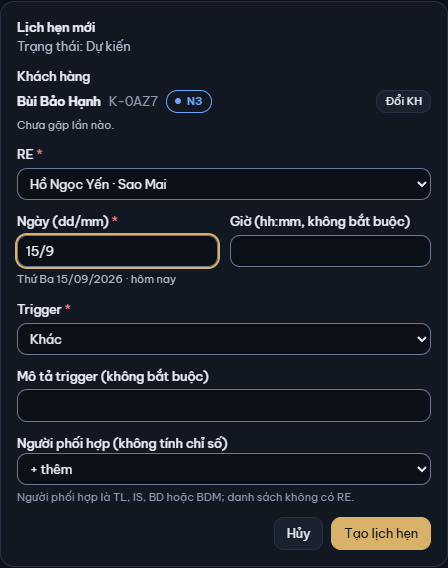
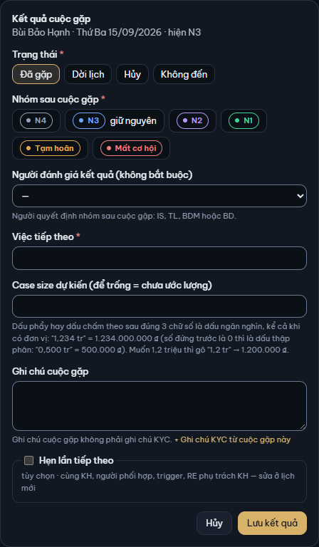
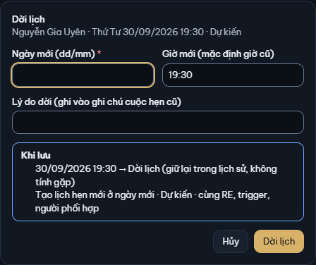

# 3. Lịch hẹn

[← Mục lục](README.md)

Màn Lịch hẹn là nơi RE làm việc hằng ngày: xem lịch, đặt lịch, ghi kết quả cuộc gặp, dời lịch.

## Xem lịch

Đầu màn có hàng **Kỳ thống kê** như ở Tổng quan (Ngày / Tuần / Tháng / Năm / Tùy chọn, mũi tên, **Hôm nay**). Ở màn này kỳ đổi ngay, không cần bấm Lọc. Ô **Phối hợp** lọc theo người phối hợp: **Bất kỳ**, **Không có người phối hợp**, hoặc một người cụ thể. Bên phải là số đếm của kỳ, ví dụ "471 lịch · 177 đã gặp".

Lịch hẹn chia 4 nhóm, cùng màu ở mọi chỗ trong màn:

| Nhóm | Nghĩa |
|---|---|
| **Đã gặp** | Đã ghi kết quả Đã gặp |
| **Dời lịch / hủy / không đến** | Đã dời, KH hủy, hoặc KH không đến |
| **Chưa ghi kết quả** | Ngày hẹn đã qua mà chưa ghi kết quả: việc cần làm |
| **Dự kiến** | Từ hôm nay trở đi, chưa có kết quả (lịch hôm nay vẫn là Dự kiến) |

### Lịch tháng

Với kỳ Ngày, Tuần, Tháng, Tùy chọn, màn hiện **Lịch tháng**: mỗi ô ngày có số lịch và một chấm màu cho mỗi lịch. Ô hôm nay có viền và chữ "hôm nay".

Bấm một ngày để xem khung **Trong ngày** bên dưới: lịch của ngày đó, xếp theo team rồi RE, có giờ, tên KH và trạng thái.

### Lịch năm

Với kỳ Năm, màn hiện **Lịch năm**: 12 tháng chia theo quý, mỗi tháng một thanh màu theo 4 nhóm, số trong thanh là số lịch. Bấm một tháng để mở kỳ Tháng đó.

### Danh sách và chi tiết

Cuối màn là bảng **Danh sách lịch hẹn** của cả kỳ: Ngày, Giờ, Khách hàng, RE, Trigger, Phối hợp, Trạng thái, Kết quả. Bấm tiêu đề cột để sắp xếp; bảng dài có nút "Hiện thêm … lịch" ở cuối.

Bấm tên KH (trong bảng hoặc khung Trong ngày) để mở **Chi tiết lịch hẹn** bên phải:

- Thông tin lịch: RE và team, Phối hợp, Trigger, Trạng thái, Kết quả, Ghi chú. **Hồ sơ KH →** mở hồ sơ KH.
- Nút theo trạng thái: lịch Dự kiến có **Ghi kết quả**, **Dời lịch**, **Xóa**; lịch đã có kết quả có **Sửa kết quả**; lịch hôm nay hoặc đã qua có **Tạo lịch hẹn tiếp theo**.
- Khối **KYC Intelligence** cho xem phân tích AI mới nhất của KH (chỉ đọc). Muốn phân tích, mở Hồ sơ KH (xem [6. KYC Intelligence](06-ai.md)).

## Đặt lịch hẹn

1. Bấm **+ Lịch hẹn** (ở màn Lịch hẹn, hoặc ở Hồ sơ KH để điền sẵn KH).
2. **Khách hàng**: gõ tên hoặc mã KH, chọn trong danh sách. Hộp hiện lần gặp thứ mấy và **Các lần hẹn trước** của KH: 5 lịch mới nhất tới hôm nay, mỗi lịch một dòng ngày, trạng thái, nhóm trước → sau của cuộc gặp, ghi chú; **Đổi KH** để chọn lại.
3. **RE**: RE phụ trách cuộc hẹn. Lịch hẹn và chỉ số tính cho RE này.
4. **Ngày (dd/mm)**: gõ ví dụ `20/9`; dòng dưới đọc lại thứ, ngày và "hôm nay" / "… ngày nữa". **Giờ (hh:mm, không bắt buộc)**.
5. **Trigger**: lý do có cuộc hẹn (Giới thiệu từ KH, Đáo hạn tài sản, Hội thảo / sự kiện, Sinh nhật, dịp đặc biệt, Khác). Bắt buộc; "—" là chưa chọn. **Mô tả trigger** không bắt buộc.
6. **Người phối hợp (không tính chỉ số)**: chọn **+ thêm** để thêm TL, IS, BD hoặc BDM đi cùng. Người phối hợp không được tính chỉ số.
7. Bấm **Tạo lịch hẹn**. Ở màn Lịch hẹn, màn chuyển tới ngày của lịch mới và mở chi tiết của nó.

Gõ một ngày đã qua, app hỏi lại (ví dụ "Ý anh là …?") và có nút **Dùng …** để lấy ngày gợi ý. App không tự đổi năm: giữ nguyên ngày đã qua là **nhập bù** một lịch hẹn quá khứ.

Đầu năm thì ngược lại: gõ `dd/mm` mà ngày đó năm nay chưa tới, còn cùng ngày năm trước mới qua không quá 60 ngày, app hỏi ngày năm trước. Ví dụ hôm nay 02/01/2027, gõ `28/12`: "28/12/2027 còn 360 ngày nữa. Ý anh là 28/12/2026?". Giữ nguyên là lịch hẹn năm nay.

Nếu RE của lịch mới nằm ngoài góc nhìn đang chọn, lịch vẫn được tạo; màn báo một dòng và bạn đổi góc nhìn để thấy nó.

## Ghi kết quả cuộc gặp

Lịch có ngày đã qua mà chưa ghi kết quả nằm ở nhóm **Chưa ghi kết quả**. Để ghi:

1. Mở chi tiết lịch, bấm **Ghi kết quả**.
2. Chọn **Trạng thái**: **Đã gặp**, **Dời lịch**, **Hủy** hoặc **Không đến**. Lịch chưa tới ngày chỉ chọn được Dời lịch hoặc Hủy.
3. Với **Đã gặp**:
   - **Nhóm sau cuộc gặp** (bắt buộc): nhóm của KH sau buổi gặp; nhóm hiện tại có chữ "giữ nguyên". Hộp cho biết lần chuyển này có **tính RF** không: RF chỉ tính khi KH đi từ N4 / N3 lên N2 / N1.
   - **Người đánh giá kết quả (không bắt buộc)**: người quyết định nhóm sau cuộc gặp (IS, TL, BDM hoặc BD).
   - **Việc tiếp theo** (bắt buộc).
   - **Case size dự kiến (để trống = chưa ước lượng)**: gõ như `800tr`, `1,2 tỷ` hoặc `500.000.000`. Dấu phẩy hay dấu chấm theo sau đúng 3 chữ số là dấu ngăn nghìn, kể cả khi có đơn vị: `1,234 tr` là 1.234.000.000 ₫; số đứng trước là 0 thì là dấu thập phân: `0,500 tr` là 500.000 ₫. Muốn 1,2 triệu thì gõ `1,2 tr`. Dòng chữ dưới ô nhắc lại các điều này.
4. **Ghi chú cuộc gặp**: không phải ghi chú KYC. Muốn lưu thông tin KH vào KYC, bấm **+ Ghi chú KYC từ cuộc gặp này** (hộp Ghi chú KYC mở với chữ và ngày điền sẵn, xem [5. Hồ sơ KH](05-ho-so-kh.md#ghi-chú-kyc)).
5. Bấm **Lưu kết quả**.

Hủy và Không đến không có nhóm sau cuộc gặp, việc tiếp theo hay case size. Chọn **Dời lịch** trong hộp này thì hộp hiện các ô của [Dời lịch](#dời-lịch).

## Hẹn tiếp

Có hai cách đặt lần gặp kế tiếp, cùng KH, người phối hợp và trigger, với RE là RE đang phụ trách KH (khác RE của lịch cũ khi KH đã đổi RE sau lịch đó):

- Lúc ghi kết quả: đánh dấu **Hẹn lần tiếp theo**, điền **Ngày hẹn tiếp (dd/mm)** và **Giờ hẹn tiếp**, rồi bấm **Lưu kết quả + tạo lịch**. Một lần bấm ghi kết quả và tạo lịch mới.
- Sau đó: bấm **Tạo lịch hẹn tiếp theo** ở chi tiết lịch, hoặc **Hẹn tiếp** / **Hẹn tiếp →** ở Hồ sơ KH. Hộp **Lịch hẹn tiếp theo** điền sẵn từ lịch cũ, sửa được (không có khối Các lần hẹn trước); ngày phải từ hôm nay trở đi. Bấm **Tạo lịch hẹn**.

## Dời lịch

Chỉ dời được lịch còn Dự kiến.

1. Mở chi tiết lịch, bấm **Dời lịch**.
2. **Ngày mới (dd/mm)**, **Giờ mới (mặc định giờ cũ)**, **Lý do dời (ghi vào ghi chú cuộc hẹn cũ)**.
3. Khung **Khi lưu** cho biết điều sẽ xảy ra: lịch cũ thành Dời lịch (giữ trong lịch sử, không tính gặp), và một lịch Dự kiến mới được tạo ở ngày mới.
4. Bấm **Dời lịch**.

Ngày mới phải từ hôm nay trở đi. Gõ một ngày đã qua, hộp hiện ô **Nhập bù: cuộc gặp đã diễn ra vào ngày này**: chỉ đánh dấu khi cuộc gặp thật sự đã diễn ra vào ngày đó và bạn đang ghi bù. Đầu năm, hộp cũng hỏi ngày năm trước như khi tạo lịch; bấm **Dùng …** thì ngày mới là ngày đã qua: ô báo lỗi và hiện ô **Nhập bù**, app không tự đánh dấu.

## Sửa kết quả

Lịch đã có kết quả (Đã gặp, Hủy, Không đến): mở chi tiết, bấm **Sửa kết quả**. Hộp **Sửa kết quả cuộc gặp** cho sửa các ô của kết quả, giờ, trigger; bấm **Lưu**.

Nếu nhóm của KH đã đổi tiếp sau cuộc gặp này, hộp khóa ba ô trạng thái, ngày cuộc hẹn và nhóm sau cuộc gặp (viền đứt, có dấu 🔒) và nói rõ lần đổi nhóm sau đó. Muốn chỉnh nhóm hiện tại, dùng **Chuyển nhóm** ở Hồ sơ KH (xem [4. Khách hàng](04-khach-hang.md#chuyển-nhóm-tay)).

## Xóa lịch hẹn

- Lịch Dự kiến: bấm **Xóa** ở chi tiết lịch.
- Lịch đã có kết quả: bấm **Sửa kết quả** rồi **Xóa lịch hẹn** trong hộp.

Hộp xóa cho biết hậu quả trước khi xóa: nhóm KH (cuộc gặp đã chuyển nhóm thì KH về nhóm cũ), RF (bớt 1 nếu cuộc gặp tính RF), ghi chú KYC (giữ nguyên). Bấm **Xóa lịch hẹn** để xóa.

Xóa là **xóa mềm**: lịch biến khỏi danh sách và chỉ số nhưng vẫn còn trong dữ liệu, khôi phục được ở **Cài đặt → Thùng rác** (xem [9. Cài đặt](09-cai-dat.md#cài-đặt--thùng-rác)). Khi nhóm KH đã đổi tiếp sau cuộc gặp, việc xóa cũng bị chặn như sửa.

[← 2. Tổng quan](02-tong-quan.md) · [4. Khách hàng →](04-khach-hang.md)
