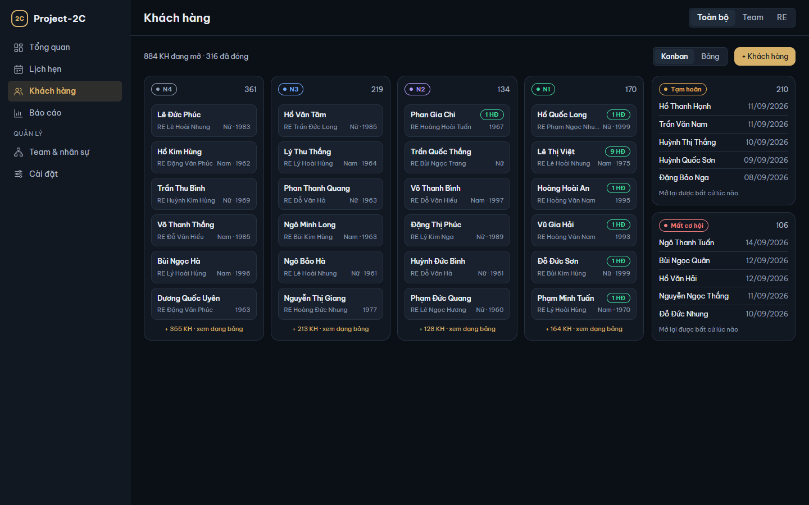
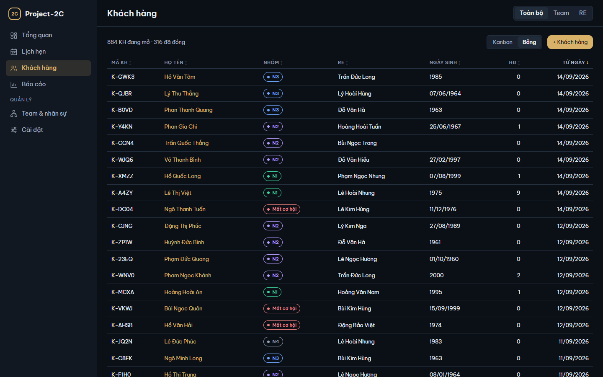
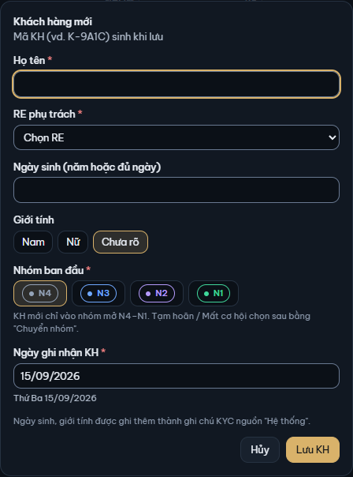
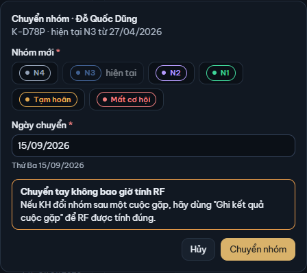

# 4. Khách hàng

[← Mục lục](README.md)

Màn Khách hàng liệt kê KH theo nhóm. Mỗi KH do một RE phụ trách và luôn ở một nhóm: bốn nhóm mở **N4** → **N3** → **N2** → **N1** (N1 gần chốt nhất) hoặc hai nhóm đóng **Tạm hoãn**, **Mất cơ hội**. Ý nghĩa từng nhóm ở [11. Thuật ngữ](11-thuat-ngu.md#khách-hàng-và-nhóm).

Đầu màn ghi số KH theo góc nhìn, ví dụ "884 KH đang mở · 316 đã đóng". Ô **Cách xem** chuyển giữa **Kanban** và **Bảng**.

## Kanban

- Bốn cột N4, N3, N2, N1, mỗi cột có số KH. Mỗi thẻ KH ghi họ tên, RE phụ trách, giới tính · năm sinh; KH đã có HĐ có nhãn số HĐ (ví dụ "1 HĐ").
- Cột dài chỉ hiện vài thẻ đầu; dòng **+ … KH · xem dạng bảng** ở cuối cột chuyển sang Bảng.
- Hai khung bên phải là KH đã đóng (**Tạm hoãn**, **Mất cơ hội**), kèm ngày đóng. KH đã đóng "Mở lại được bất cứ lúc nào" bằng [Chuyển nhóm](#chuyển-nhóm-tay).
- Bấm một thẻ (hoặc một tên) để mở [Hồ sơ KH](05-ho-so-kh.md).

## Bảng

Bảng có mọi KH của góc nhìn: **Mã KH**, **Họ tên**, **Nhóm**, **RE**, **Ngày sinh**, **HĐ** (số HĐ), **Từ ngày** (ngày vào nhóm hiện tại). Bấm tiêu đề cột để sắp xếp; bấm tên để mở hồ sơ. Bảng dài có nút "Hiện thêm … khách hàng" ở cuối.

## Tạo KH

1. Bấm **+ Khách hàng**.
2. Điền **Họ tên** và chọn **RE phụ trách**.
3. **Ngày sinh (năm hoặc đủ ngày)**: gõ năm (`1984`) hoặc đủ ngày (`12/03/1984`); không bắt buộc. **Giới tính**: Nam, Nữ hoặc Chưa rõ.
4. **Nhóm ban đầu**: N4, N3, N2 hoặc N1. KH mới chỉ vào nhóm mở; Tạm hoãn / Mất cơ hội chọn sau bằng "Chuyển nhóm".
5. **Ngày ghi nhận KH**: mặc định hôm nay, không được sau hôm nay.
6. Bấm **Lưu KH**. Mã KH (ví dụ K-9A1C) được sinh khi lưu.

Ngày sinh và giới tính được ghi thêm thành ghi chú KYC nguồn "Hệ thống", nên chúng hiện ở thẻ Dữ kiện KYC của hồ sơ. Hai trường này chỉ sửa ở hồ sơ KH, không sửa bằng ghi chú KYC.

## Sửa hồ sơ KH

1. Mở hồ sơ KH, bấm **Sửa hồ sơ**.
2. Sửa họ tên, RE phụ trách, ngày sinh, giới tính. Nhóm không sửa ở đây (đổi nhóm ở "Chuyển nhóm").
3. Khung **Khi lưu, app tự ghi vào KYC** cho biết app có tạo phiên bản KYC mới không (khi ngày sinh / giới tính đổi).
4. Bấm **Lưu**.

Đổi RE phụ trách: từ nay KH thuộc RE mới, và khi lưu, mọi lịch hẹn **Dự kiến** (từ hôm nay trở đi, chưa ghi kết quả) chuyển sang RE mới — hộp báo trước "Khi lưu: n lịch hẹn Dự kiến chuyển sang RE mới.". Lịch hẹn khác (đã có kết quả, hoặc đã qua mà chưa ghi kết quả) và HĐ vẫn tính cho RE đã ghi trên từng bản ghi.

## Xóa KH

1. Mở hồ sơ KH, bấm **Sửa hồ sơ**, rồi **Xóa KH…**.
2. Hộp **Xóa …?** liệt kê những gì bị ẩn cùng KH: lịch hẹn (bao nhiêu đã gặp, bao nhiêu lần tính RF), hợp đồng, ghi chú KYC.
3. Bấm **Xóa KH**.

KH và mọi bản ghi của KH biến khỏi danh sách và mọi chỉ số. Dữ liệu vẫn còn: khôi phục ở **Cài đặt → Thùng rác** (xem [9. Cài đặt](09-cai-dat.md#cài-đặt--thùng-rác)). Dọn sạch Thùng rác thì KH bị xóa hẳn cùng mọi bản ghi của KH, kể cả ghi chú KYC (xem [Dọn sạch Thùng rác](09-cai-dat.md#dọn-sạch-thùng-rác)).

## Chuyển nhóm tay

Dùng khi KH đổi nhóm **ngoài cuộc gặp** (ví dụ được gửi giải pháp qua điện thoại), hoặc để đóng / mở lại KH.

1. Mở hồ sơ KH, bấm **Chuyển nhóm**.
2. Chọn **Nhóm mới** (nhóm hiện tại ghi "hiện tại").
3. **Ngày chuyển**: mặc định hôm nay; không được sau hôm nay, không được trước lần đổi nhóm gần nhất.
4. Bấm **Chuyển nhóm**.

**Chuyển tay không bao giờ tính RF.** Nếu KH đổi nhóm sau một cuộc gặp, hãy ghi ở [Ghi kết quả](03-lich-hen.md#ghi-kết-quả-cuộc-gặp) của cuộc hẹn đó để RF được tính đúng.

KH đã đóng chỉ mở lại về **N3** (nhóm ghi "mở lại"), hoặc chuyển sang nhóm đóng còn lại. Mở lại không tính RF.

[← 3. Lịch hẹn](03-lich-hen.md) · [5. Hồ sơ KH →](05-ho-so-kh.md)
