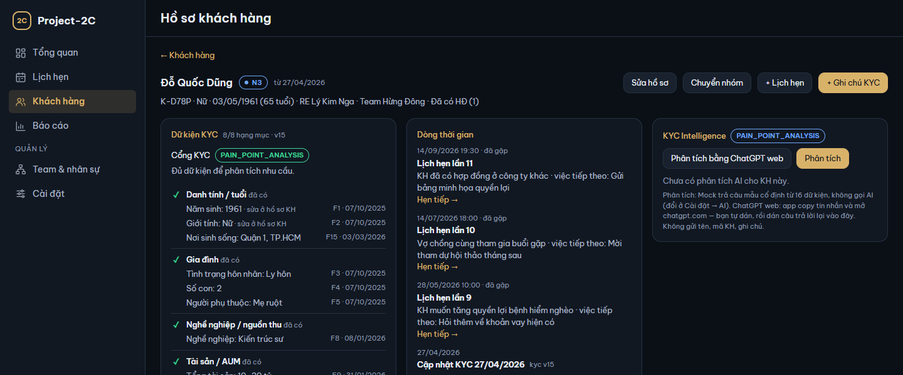
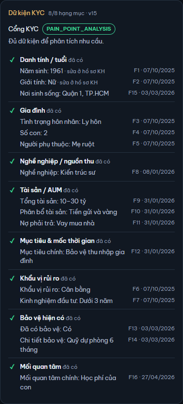
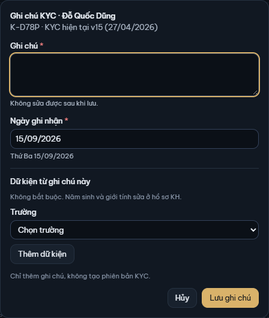
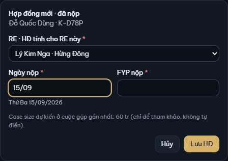

# 5. Hồ sơ KH

[← Mục lục](README.md)

Hồ sơ KH gom mọi thứ về một KH: KYC, dòng thời gian, hợp đồng, lịch hẹn và phân tích AI. Mở từ màn Khách hàng (bấm thẻ hoặc tên), từ chi tiết lịch hẹn (**Hồ sơ KH →**), hoặc từ Thùng rác sau khi khôi phục. **← Khách hàng** quay lại danh sách.

Cửa sổ rộng từ 1 440 px (cỡ mặc định của app) chia hồ sơ ba cột: **Dữ kiện KYC** và **Hợp đồng** · **Dòng thời gian** và **Lịch hẹn** · **KYC Intelligence**. Cửa sổ hẹp hơn còn hai cột, KYC Intelligence xuống cuối hồ sơ.

Đầu hồ sơ: họ tên, nhóm hiện tại và ngày vào nhóm; dòng dưới là mã KH, giới tính, ngày sinh (tuổi), RE, team, "Đã có HĐ (…)" hoặc "Chưa có HĐ". Các nút:

| Nút | Làm gì | Xem |
|---|---|---|
| **Sửa hồ sơ** | Sửa họ tên, RE, ngày sinh, giới tính; xóa KH | [4. Khách hàng](04-khach-hang.md#sửa-hồ-sơ-kh) |
| **Chuyển nhóm** | Đổi nhóm ngoài cuộc gặp, đóng / mở lại KH | [4. Khách hàng](04-khach-hang.md#chuyển-nhóm-tay) |
| **+ Lịch hẹn** | Đặt lịch hẹn, KH điền sẵn | [3. Lịch hẹn](03-lich-hen.md#đặt-lịch-hẹn) |
| **+ Ghi chú KYC** | Ghi điều mới biết về KH, kèm dữ kiện | [Ghi chú KYC](#ghi-chú-kyc) |

## Dữ kiện KYC

KYC của KH gồm **ghi chú** (RE viết, chỉ thêm, không sửa / xóa) và **dữ kiện** (giá trị có cấu trúc RE đã xác nhận, trỏ về ghi chú nguồn). Thẻ **Dữ kiện KYC** hiện các dữ kiện còn hiệu lực:

- Dòng đầu: số hạng mục đã có trên 8 và phiên bản KYC hiện tại (ví dụ "8/8 hạng mục · v15").
- **Cổng KYC**: trạng thái cho biết KH đã đủ thông tin để phân tích AI chưa, kèm một câu giải thích:

  | Trạng thái | Câu trên màn |
  |---|---|
  | `CONFLICT_RESOLUTION` | Có mâu thuẫn ở trường cốt lõi: cần làm rõ trước khi phân tích. |
  | `KYC_INSUFFICIENT` | Cần chăm sóc, KYC thêm thông tin khách hàng |
  | `PROFILE_DISCOVERY` | Đủ thông tin tối thiểu; nên khám phá thêm các hạng mục còn thiếu. |
  | `PAIN_POINT_ANALYSIS` | Đủ dữ kiện để phân tích nhu cầu. |

- 8 hạng mục: Danh tính / tuổi, Gia đình, Nghề nghiệp / nguồn thu, Tài sản / AUM, Mục tiêu & mốc thời gian, Khẩu vị rủi ro, Bảo vệ hiện có, Mối quan tâm. Mỗi hạng mục ghi "đã có" (✓) hoặc "thiếu" (○).
- Mỗi dữ kiện ghi trường, giá trị, **mã F** (F1, F2…) và ngày xác nhận. Mã F là tên ngắn của dữ kiện, phân tích AI dùng nó để trỏ về bằng chứng (xem [6. KYC Intelligence](06-ai.md#bằng-chứng-và-mức-bằng-chứng)).
- Năm sinh và giới tính có chữ "sửa ở hồ sơ KH": hai trường này lấy từ hồ sơ, chỉ sửa bằng **Sửa hồ sơ**.
- **Câu hỏi gợi ý**: bấm để mở các câu nên hỏi KH cho hạng mục còn thiếu.

## Ghi chú KYC

1. Bấm **+ Ghi chú KYC**.
2. **Ghi chú**: điều mới biết về KH. Không sửa được sau khi lưu.
3. **Ngày ghi nhận**: mặc định hôm nay.
4. **Dữ kiện từ ghi chú này** (không bắt buộc): chọn **Trường** (thay cho "Chọn trường"), điền **Giá trị**, bấm **Thêm dữ kiện**. Thêm được nhiều dữ kiện; **Bỏ** để gỡ một dữ kiện chưa lưu.
5. Nếu trường đã có giá trị, chọn ở **Trường đã có giá trị**:
   - **Cập nhật**: giá trị mới thay giá trị đang có (giá trị cũ thành cũ).
   - **Đánh dấu mâu thuẫn**: chưa rõ giá trị nào đúng, giữ cả hai tới khi [giải quyết](#mâu-thuẫn).
6. Cuối hộp cho biết kết quả: "Sau khi lưu: KYC v…" (dữ kiện đổi → phiên bản KYC mới) hoặc "Chỉ thêm ghi chú, không tạo phiên bản KYC." Đổi trường cốt lõi (năm sinh, tình trạng hôn nhân, số con, tổng tài sản, mục tiêu chính) tự đánh dấu "thay đổi quan trọng"; trường khác thì bạn tự chọn **Đánh dấu là thay đổi quan trọng — nên phân tích AI lại** khi cần.
7. Bấm **Lưu ghi chú**.

Ghi chú lưu xong hiện ở Dòng thời gian, có nút **AI trích xuất** để AI đề xuất dữ kiện từ chữ của ghi chú (xem [6. KYC Intelligence](06-ai.md#ai-trích-xuất)).

Từ hộp Kết quả cuộc gặp, **+ Ghi chú KYC từ cuộc gặp này** mở hộp này với chữ và ngày của cuộc gặp điền sẵn.

## Mâu thuẫn

Mâu thuẫn là hai dữ kiện đã xác nhận cùng trường, khác giá trị, đều còn hiệu lực. Thẻ Dữ kiện KYC ghi **Mâu thuẫn cốt lõi** (ở trường cốt lõi, chặn phân tích AI, cổng KYC là `CONFLICT_RESOLUTION`) hoặc **Mâu thuẫn phụ** (chỉ cảnh báo, AI vẫn chạy).

Để giải quyết:

1. Bấm **Giải quyết** cạnh trường mâu thuẫn.
2. Ở hộp **Giải quyết · …**, chọn **Giá trị đúng**. Giá trị còn lại thành cũ; ghi chú gốc giữ nguyên.
3. Hộp cho biết phiên bản KYC và cổng KYC sau khi lưu. Bấm **Giải quyết**.

Không giá trị nào đúng? Thêm ghi chú KYC mới với giá trị đúng (chọn **Cập nhật**): xác nhận giá trị mới cũng giải quyết mâu thuẫn.

## Dòng thời gian

Thẻ **Dòng thời gian** xếp mọi việc của KH, mới nhất ở trên:

- **Lịch hẹn lần …**: ngày giờ và trạng thái, ghi chú cuộc gặp, việc tiếp theo; người phối hợp (vai trò) nếu có. **Hẹn tiếp →** đặt lần gặp kế tiếp (xem [3. Lịch hẹn](03-lich-hen.md#hẹn-tiếp)).
- Chuyển nhóm: nhóm cũ → nhóm mới, ghi "tạo KH", "chuyển tay · không tính RF", "sau cuộc gặp · tính 1 RF" (cuộc gặp đưa KH từ N4 / N3 lên N2 / N1) hoặc "sau cuộc gặp · không tính RF" (các lần chuyển khác sau cuộc gặp, ví dụ N4 → N3, N2 → N1).
- **Ghi chú KYC** (kèm nút **AI trích xuất**) và **Ghi chú hệ thống** (ghi chú app tự ghi từ hồ sơ KH, không có nút AI trích xuất).
- Phiên bản KYC mới ("kyc v…"). Phiên bản có thay đổi quan trọng (đổi trường cốt lõi hoặc được đánh dấu) có nhãn "thay đổi quan trọng"; kyc v1 luôn có nhãn này.

## Hợp đồng

Thẻ **Hợp đồng** liệt kê HĐ của KH. Mỗi HĐ có hai bước: **Đã nộp** (KH đã đóng phí, có FYP nộp) → **Đã phát hành** (có ngày phát hành, FYP phát hành).

### Ghi HĐ nộp

1. Bấm **+ Hợp đồng**.
2. **RE · HĐ tính cho RE này**: mặc định RE phụ trách KH; chỉ chọn được lúc tạo HĐ.
3. **Ngày nộp** và **FYP nộp** (phí năm đầu; gõ như `800tr`, `1,2 tỷ`). FYP tối đa 100 tỷ đồng. Hộp nhắc case size dự kiến của cuộc gặp gần nhất để tham khảo, không tự điền.
4. Bấm **Lưu HĐ**.

### Phát hành HĐ

1. Ở dòng HĐ đã nộp, bấm **Phát hành**.
2. **Ngày phát hành** (không trước ngày nộp). **FYP phát hành** mặc định bằng FYP nộp, sửa tay được.
3. Bấm **Phát hành**.

HĐ nộp tháng này mà phát hành tháng sau thì vẫn tính nộp vào tháng nộp, tính phát hành (Doanh số) vào tháng phát hành; hộp ghi rõ điều này.

### Sửa, xóa HĐ

- Bấm **Sửa** ở dòng HĐ. Hộp **Sửa HĐ · …** cho sửa ngày nộp, FYP nộp và, với HĐ đã phát hành, ngày phát hành, FYP phát hành (RE của HĐ không đổi được). Khi FYP phát hành đổi, khung **Ảnh hưởng chỉ số** cho biết FYP phát hành của tháng nào tăng / giảm bao nhiêu. Bấm **Lưu**.
- Muốn xóa: trong hộp Sửa HĐ bấm **Xóa HĐ…**, rồi **Xóa HĐ**. HĐ không còn tính vào FYP nộp / phát hành của RE; nhóm của KH không đổi. Xóa mềm: khôi phục ở **Cài đặt → Thùng rác** (xem [9. Cài đặt](09-cai-dat.md#cài-đặt--thùng-rác)).

## Lịch hẹn của KH

Thẻ **Lịch hẹn** liệt kê mọi lịch của KH. Mỗi lịch hôm nay hoặc đã qua có nút **Hẹn tiếp** (tạo lịch hẹn tiếp theo, điền sẵn từ lịch đó). Ghi chú dài bị cắt một dòng; người phối hợp xem ở Dòng thời gian.

## KYC Intelligence

Thẻ **KYC Intelligence** (cột phải; cửa sổ hẹp hơn 1 440 px thì ở cuối hồ sơ) chạy và hiện phân tích AI của KH. Cách dùng ở [6. KYC Intelligence](06-ai.md).

[← 4. Khách hàng](04-khach-hang.md) · [6. KYC Intelligence →](06-ai.md)
