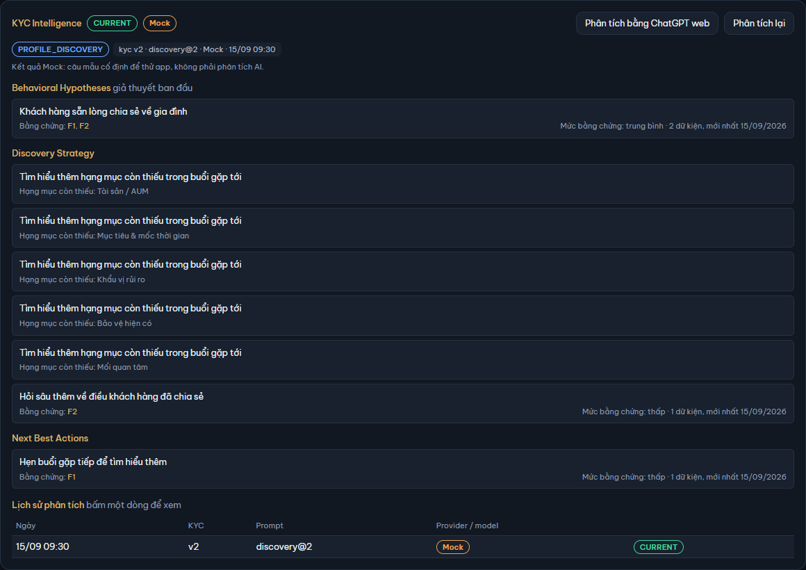

# 6. KYC Intelligence

[← Mục lục](README.md)

**KYC Intelligence** là phần AI của app. Từ các dữ kiện KYC bạn đã xác nhận, AI gợi ý giả thuyết về KH, nhu cầu và hướng khám phá cho buổi gặp tới. AI chỉ gợi ý: không tự chạy, không tự ghi dữ kiện, không gửi tin hay đặt lịch. Mọi lần gọi AI đều do bạn bấm.

Thẻ **KYC Intelligence** nằm ở cột phải của [Hồ sơ KH](05-ho-so-kh.md) (cửa sổ hẹp hơn 1 440 px thì ở cuối hồ sơ). Chi tiết lịch hẹn cũng hiện phân tích mới nhất của KH (chỉ đọc, xem [cuối mục này](#ở-chi-tiết-lịch-hẹn)).

## Mock, OpenCode và ChatGPT web

AI chạy theo một trong ba cách:

| Cách | Là gì |
|---|---|
| **Mock** | Câu mẫu cố định, không gọi mạng, chỉ để thử app. Kết quả luôn gắn nhãn Mock và dòng "Kết quả Mock: câu mẫu cố định để thử app, không phải phân tích AI." |
| **OpenCode** (bản exe) | Gọi model thật qua tài khoản OpenCode, cần API key. Chọn ở **Cài đặt → AI** (xem [9. Cài đặt](09-cai-dat.md#cài-đặt--ai)) |
| **ChatGPT web** | Bạn tự dán tin nhắn vào ChatGPT bằng tài khoản của mình rồi dán câu trả lời về app. Chỉ dùng cho phân tích, xem [Phân tích bằng ChatGPT web](#phân-tích-bằng-chatgpt-web) |

App mới cài dùng Mock. Bản web chỉ có Mock và ChatGPT web.

## Khi nào phân tích được

Nút **Phân tích** theo **Cổng KYC** của thẻ Dữ kiện KYC (xem [5. Hồ sơ KH](05-ho-so-kh.md#dữ-kiện-kyc)):

| Cổng KYC | Thẻ KYC Intelligence |
|---|---|
| `CONFLICT_RESOLUTION` | Nút tắt: "Giải quyết mâu thuẫn ở … trước khi phân tích." Xem [Mâu thuẫn](05-ho-so-kh.md#mâu-thuẫn) |
| `KYC_INSUFFICIENT` | Nút tắt: "Cần chăm sóc, KYC thêm thông tin khách hàng. Còn thiếu: … — câu hỏi gợi ý ở thẻ Dữ kiện KYC." Bấm **Xem ở Dữ kiện KYC →** |
| `PROFILE_DISCOVERY` | Phân tích được, chế độ `discovery`: KH còn thiếu hạng mục, AI tập trung vào việc cần hỏi thêm |
| `PAIN_POINT_ANALYSIS` | Phân tích được, chế độ `analysis`: đủ dữ kiện để phân tích nhu cầu |

## Phân tích

1. Bấm **Phân tích** (đã có kết quả thì là **Phân tích lại**). Dòng nhỏ dưới tiêu đề cho biết sẽ gửi gì và tới đâu, ví dụ "Phân tích: gửi 6 dữ kiện đã xác nhận tới OpenCode · … (đổi ở Cài đặt → AI)." và "Không gửi tên, mã KH, ghi chú."
2. Thẻ hiện "Đang phân tích…", mỗi lần thử tối đa 2 phút. Bấm **Hủy** để dừng; thẻ hiện "Đang hủy…" tới khi yêu cầu đang chạy kết thúc.
3. App kiểm câu trả lời của AI (đúng khuôn, mọi ý có bằng chứng, không vượt [giới hạn](#giới-hạn-của-ai)). Chưa đạt thì app tự hỏi lại AI một lần. Lần thứ hai vẫn chưa đạt thì lần phân tích **bị loại** (xem [Lần phân tích bị loại](#lần-phân-tích-bị-loại)).

Mỗi lúc cả app chỉ chạy một yêu cầu AI (phân tích, AI trích xuất hoặc Kiểm tra kết nối). Trong lúc đó mọi nút AI khác tắt; chờ xong rồi bấm.

Lỗi khi gọi AI (chưa có key, hết hạn mức, mất mạng…) hiện ngay trong thẻ, kèm **Thử lại**. Lỗi không tính là một lần thử và không lưu gì. Danh sách lỗi ở [10. Khi có lỗi](10-su-co.md#lỗi-ai-thường-gặp).

## Đọc kết quả

Đầu thẻ:

- Trạng thái của kết quả đang hiện: `CURRENT` hoặc `STALE` (xem [dưới](#current-và-stale)), cạnh đó là nhãn Mock / ChatGPT web khi có.
- Chip "kyc v… · … · … · …": phiên bản KYC đã phân tích, chế độ và phiên bản prompt (ví dụ `discovery@4`), model (hoặc Mock / ChatGPT web), ngày giờ phân tích.

Các khối gợi ý:

| Khối | Có ở chế độ | Nội dung |
|---|---|---|
| **Behavioral Hypotheses** | cả hai | Giả thuyết về KH ("giả thuyết, cần kiểm chứng"; ở discovery là "giả thuyết ban đầu") |
| **Needs · Pain points · Opportunity Themes** | analysis | Nhu cầu, điều KH đang lo, chủ đề có thể tư vấn |
| **Discovery Strategy** | cả hai | Nên hỏi / tìm hiểu gì tiếp |
| **Next Best Actions** | cả hai | Việc nên làm tiếp với KH |
| **Thông tin tham khảo — không phải kết luận** | khi AI có ghi | Dòng "Tâm lý học:" (MBTI, DISC…) hoặc "Tử vi / huyền học:" (con giáp, mệnh…), cũng phải có bằng chứng. Chỉ để tham khảo |

Có mâu thuẫn phụ lúc phân tích thì thẻ ghi "Mâu thuẫn phụ ở "…" (…) — phân tích vẫn chạy, cần RE làm rõ."

### Bằng chứng và mức bằng chứng

Mỗi ý ghi **Bằng chứng: F…**: mã F của các dữ kiện KYC mà ý đó dựa vào (mã F xem ở thẻ Dữ kiện KYC). Bấm một mã để tới dữ kiện đó. Dữ kiện đã đổi giá trị thì thẻ ghi "F… không còn hiệu lực."

Bên phải ghi "Mức bằng chứng: … · n dữ kiện, mới nhất dd/mm/yyyy":

| Số dữ kiện được trích | Mức |
|---|---|
| 1 | thấp |
| 2 | trung bình |
| 3 trở lên | cao |

Nếu mọi dữ kiện được trích đều xác nhận từ hơn một năm trước ngày phân tích, mức hạ một bậc (thấp giữ thấp). Mức bằng chứng do app đếm, không phải AI tự chấm; không có số %.

Ý gợi ý hỏi thêm về một hạng mục còn thiếu ghi "Hạng mục còn thiếu: …" thay cho bằng chứng.

## CURRENT và STALE

- `CURRENT`: lần phân tích mới nhất, làm trên phiên bản KYC hiện tại.
- `STALE`: KYC đã có phiên bản mới sau lần phân tích (hoặc đã có lần phân tích mới hơn). Kết quả vẫn hiện, mờ đi, kèm lời nhắc:
  - "KYC đã đổi ở trường cốt lõi từ … — nên phân tích lại." (có thay đổi quan trọng), hoặc
  - "KYC có thay đổi nhỏ từ …".

Bấm **Phân tích lại** để có kết quả `CURRENT`. App không tự phân tích lại khi KYC đổi.

## Lần phân tích bị loại

Khi lần gần nhất bị loại, thẻ ghi "Lần phân tích … bị loại: …" với lý do đầu tiên, và vẫn hiện kết quả đạt gần nhất bên dưới. Bấm **Xem chi tiết** để mở hộp **Lần phân tích … bị loại**: số lần thử, số token, lỗi của từng lần thử (mã lỗi, vị trí, chi tiết). Kết quả bị loại không bao giờ dùng làm phân tích. Khối JSON của câu trả lời cuối dài quá 20.000 ký tự thì app không lưu nó: lỗi của lần đó vẫn hiện, kèm dòng "Output quá lớn (trên 20.000 ký tự), app không lưu." Bấm **Đóng**.

Lý do hay gặp: ý trỏ tới mã F không có trong dữ kiện, câu trả lời vượt [giới hạn](#giới-hạn-của-ai), "Không có khối JSON hợp lệ" (AI không trả đúng khuôn), "Trả lời bị cắt vì hết giới hạn token, khối JSON chưa xong". Thường chỉ cần **Phân tích lại**; lặp lại nhiều lần thì thử model khác ở Cài đặt → AI.

## Lịch sử phân tích

Bảng **Lịch sử phân tích** ở cuối thẻ liệt kê mọi lần gọi AI của KH, mới nhất ở trên: **Ngày**, **KYC** (phiên bản), **Prompt**, **Provider / model**, **Trạng thái** (CURRENT / STALE / REJECTED). Cổng KYC chặn thì không ghi vào lịch sử.

Bấm một dòng để xem lại kết quả lần đó: thẻ ghi "Đang xem lần …"; bấm **← Về bản mới nhất** để quay lại. Bấm dòng REJECTED mở hộp lỗi như [trên](#lần-phân-tích-bị-loại).

## Phân tích bằng ChatGPT web

Dùng model ChatGPT trong tài khoản ChatGPT của bạn, không tốn API. App không gửi gì tới ChatGPT: app chỉ copy tin nhắn và mở trang, bạn tự dán qua lại. Nút có cùng điều kiện cổng KYC như **Phân tích**.

1. Bấm **Phân tích bằng ChatGPT web**. App copy tin nhắn (dữ kiện KYC, không có tên, mã KH) và mở chatgpt.com trong trình duyệt. Thẻ ghi "Đã copy tin nhắn và mở ChatGPT — dán tin nhắn vào ChatGPT, chờ trả lời, bấm copy câu trả lời rồi dán vào đây."
2. Ở ChatGPT: đăng nhập, chọn model, dán tin nhắn (Ctrl+V), chờ trả lời xong, bấm nút copy của câu trả lời.
3. Về app: dán vào khung **Dán kết quả**, bấm **Kiểm tra và lưu**.
4. Đạt: kết quả được lưu, chip và lịch sử ghi "ChatGPT web".
5. Chưa đạt: thẻ ghi "Câu trả lời chưa đạt — còn 1 lần thử" kèm danh sách lỗi. Bấm **Copy yêu cầu sửa**, dán vào **cùng cuộc chat** ChatGPT, rồi dán câu trả lời mới vào khung (lần thử 2 / 2) và bấm **Kiểm tra và lưu**. Lần 2 vẫn chưa đạt thì lần phân tích bị loại.

Trong lúc chờ dán:

- **Copy lại** copy tin nhắn lần nữa; **Mở lại ChatGPT** mở lại trang. **Hủy** bỏ phiên, không lưu gì; rời Hồ sơ KH cũng bỏ phiên.
- Mọi nút AI của KH này tắt (Phân tích, AI trích xuất), KH khác vẫn phân tích được.
- Không copy được: thẻ hiện ô **Tin nhắn để copy**; bấm vào ô, Ctrl+A rồi Ctrl+C. Không mở được trình duyệt: tự mở chatgpt.com.
- Khung dán báo lỗi mà không tính lần thử khi câu dán dài quá 20.000 ký tự, hoặc khi bạn dán nhầm tin nhắn của app ("Đây là tin nhắn của app — hãy copy câu trả lời của ChatGPT.").

## AI trích xuất

AI đọc chữ của một ghi chú KYC và đề xuất dữ kiện; bạn xác nhận từng dữ kiện thì mới ghi vào KYC.

1. Ở thẻ **Dòng thời gian** của Hồ sơ KH, bấm **AI trích xuất** dưới một ghi chú KYC. Ghi chú hệ thống không có nút này; ghi chú dưới 20 ký tự có nút tắt, ghi "Ghi chú quá ngắn".
2. Chờ "Đang trích xuất…".
3. Khung **Đề xuất của AI** liệt kê từng dòng "AI đề xuất: *trường*: *giá trị* ("*đoạn trích từ ghi chú*")". Đề xuất trùng dữ kiện đang có được ẩn.
4. Mỗi dòng: **Bỏ** để gạt đi, **Xác nhận** để mở hộp **+ Dữ kiện · …**.
5. Trong hộp: xem đoạn "AI trích từ ghi chú:", sửa **Giá trị** nếu cần ("Sửa được trước khi lưu."). Trường đã có giá trị thì chọn **Cập nhật** hoặc **Đánh dấu mâu thuẫn** như khi [ghi chú KYC](05-ho-so-kh.md#ghi-chú-kyc). Bấm **Xác nhận dữ kiện**.

Đề xuất không lưu: rời màn là mất ("Đề xuất không lưu — rời màn là mất."). AI không tìm thấy gì thì ghi "AI không tìm thấy dữ kiện mới trong ghi chú này."; bấm **Đóng**.

Với OpenCode, AI trích xuất gửi **nguyên văn ghi chú** tới OpenCode, mà ghi chú có thể có tên người. Không dùng được qua ChatGPT web.

## Ở chi tiết lịch hẹn

Chi tiết một lịch hẹn ở màn Lịch hẹn có khối **KYC Intelligence** chỉ đọc: Next Best Actions và Discovery Strategy của kết quả đạt mới nhất, kèm CURRENT / STALE và ngày. Không có nút gọi AI ở đây. Chưa có phân tích thì ghi "Chưa có phân tích AI." với liên kết **Mở Hồ sơ KH để phân tích →**.

## Dữ liệu gửi đi

| Việc | Gửi gì |
|---|---|
| Phân tích | Chỉ các dữ kiện KYC đã xác nhận còn hiệu lực (trường, giá trị, ngày xác nhận), tuổi thay cho năm sinh, hạng mục còn thiếu. **Không** gửi tên, mã KH, tên RE, ghi chú KYC, lịch hẹn, HĐ |
| AI trích xuất | Nguyên văn một ghi chú KYC |
| ChatGPT web | App không gửi; bạn tự dán tin nhắn (như Phân tích) vào tài khoản ChatGPT của mình |
| Kiểm tra kết nối | Một chữ "ping" |

Cùng nội dung này ghi ở **Cài đặt → AI**, mục "Dữ liệu gửi đi".

## Giới hạn của AI

AI là trợ lý khám phá nhu cầu, không phải công cụ bán hàng. App kiểm mọi câu trả lời và **loại** kết quả có:

- Gợi ý sản phẩm: tên sản phẩm hoặc hãng bảo hiểm.
- Đoán khả năng mua: số phần trăm, xác suất, khả năng chốt, tỉ lệ chốt và lời đoán tương tự.
- Nhãn tính cách (MBTI, DISC, cung hoàng đạo, nhóm máu…) nằm ngoài khối Thông tin tham khảo.
- Trích dẫn văn bản pháp lý: Điều …, Luật …, Nghị định, Thông tư, số hiệu văn bản.
- Ý không trỏ về dữ kiện có thật (mã F sai), hoặc gợi ý hạng mục thiếu mà KH không thiếu.

Kết quả đạt vẫn chỉ là gợi ý: kiểm lại với KH trước khi dùng. Thông tin tham khảo không phải kết luận về KH.

[← 5. Hồ sơ KH](05-ho-so-kh.md) · [7. Báo cáo →](07-bao-cao.md)
