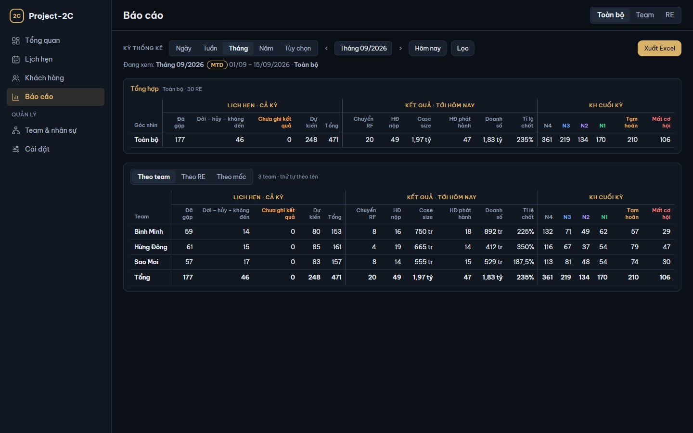
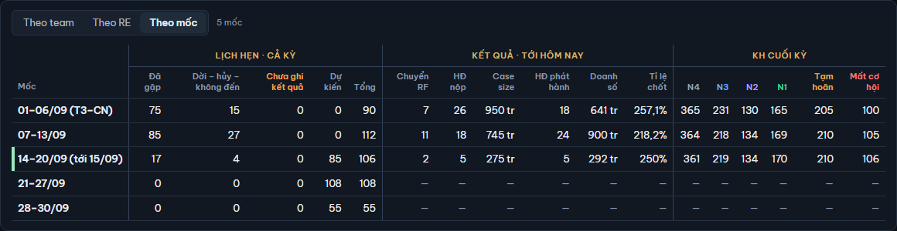

# 7. Báo cáo

[← Mục lục](README.md)

Màn Báo cáo đặt số liệu của một kỳ thành bảng: lịch hẹn, kết quả (các chỉ số của Tổng quan và các số của HĐ hủy) và KH theo nhóm, chia theo team, theo RM hoặc theo từng mốc thời gian. Mọi bảng xuất được ra Excel.

## Chọn kỳ và góc nhìn

Viên **kỳ** và viên **góc nhìn** trên thanh công cụ dùng như ở Tổng quan (xem [2. Tổng quan](02-tong-quan.md#chọn-kỳ-và-góc-nhìn)): lùi / tiến kỳ bằng ‹ ›, bấm tên kỳ để chọn loại kỳ, bấm viên góc nhìn để chọn góc nhìn. Chọn xong là bảng đổi ngay. Dòng dưới tên màn cho biết bảng đang tính cho kỳ và góc nhìn nào.

Khác Tổng quan: ở Báo cáo, menu góc nhìn chọn được một team (**Cả team**), và bảng chỉ tính team đó.

Bấm một ô chỉ số ở [Tổng quan](02-tong-quan.md#doanh-số-và-6-chỉ-số-của-kỳ) là mở Báo cáo ở cùng kỳ và góc nhìn của Tổng quan. Mở Báo cáo từ sidebar thì vẫn là tháng hiện tại.

## Các cột

Mọi bảng có cùng ba nhóm cột:

| Nhóm cột | Cột | Tính thế nào |
|---|---|---|
| **Lịch hẹn · cả kỳ** | Đã gặp · Dời – hủy – không đến · Chưa ghi kết quả · Dự kiến · Tổng | Mọi lịch hẹn trong cả kỳ, kể cả lịch sau hôm nay; 4 nhóm như ô Lịch hẹn của [Tổng quan](02-tong-quan.md#ô-lịch-hẹn) |
| **Kết quả · tới hôm nay** | Chuyển RF · HĐ nộp · Case size · HĐ phát hành · HĐ hủy · Tổng số HĐ · FYP phát hành · FYP hủy · Doanh số · Tỷ lệ hủy · Tỷ lệ chốt | Như các ô của [Tổng quan](02-tong-quan.md#doanh-số-và-6-chỉ-số-của-kỳ), tính tới hôm nay; thêm HĐ phát hành, HĐ hủy (HĐ có ngày hủy trong kỳ), FYP phát hành và FYP hủy. Doanh số = FYP phát hành − FYP hủy |
| **KH cuối kỳ** | N4 · N3 · N2 · N1 · Tạm hoãn · Mất cơ hội | Số KH ở mỗi nhóm vào cuối ngày cuối kỳ (kỳ chưa hết: hôm nay), kể cả nhóm đã đóng |

Kỳ chưa bắt đầu thì Kết quả và KH cuối kỳ hiện "—". Tỷ lệ chốt hiện "—" khi không có RF, Tỷ lệ hủy khi không có HĐ phát hành. Tổng số HĐ và Doanh số âm (hủy nhiều hơn phát hành trong kỳ) ghi dấu "-" đứng đầu, chữ đỏ.

## Tổng hợp

Bảng **Tổng hợp** luôn ở trên: một dòng cho cả góc nhìn đang xem (ví dụ "Toàn bộ · 30 RM").

## Theo team, Theo RM, Theo mốc

Bảng thứ hai chọn bằng ô **Theo team** / **Theo RM** / **Theo mốc**:

- **Theo team**: mỗi team một dòng, xếp theo tên, dòng **Tổng** ở cuối.
- **Theo RM**: mỗi RM một dòng (cột Team, RM), xếp theo team rồi tên, dòng **Tổng** ở cuối.
- **Theo mốc**: mỗi mốc thời gian của kỳ một dòng, cho góc nhìn đang xem. Không có dòng Tổng: cộng các mốc ra đúng bảng Tổng hợp.

Dòng **Tổng** cộng các dòng trên; hai tỷ lệ của dòng Tổng tính từ tổng, không lấy trung bình: Tỷ lệ chốt = tổng HĐ phát hành ÷ tổng RF, Tỷ lệ hủy = tổng HĐ hủy ÷ tổng HĐ phát hành.

Bảng nào trùng Tổng hợp thì không có: góc nhìn Team không có Theo team; góc nhìn RM chỉ có Theo mốc.

### Theo mốc

| Loại kỳ | Mỗi mốc là |
|---|---|
| Ngày | Chính ngày đó (một dòng) |
| Tuần | Một ngày |
| Tháng | Một tuần Thứ Hai → Chủ nhật, cắt ở đầu và cuối tháng (ví dụ "01–06/09 (T3–CN)") |
| Năm | Một tháng |
| Tùy chọn | Một ngày (kỳ tới 31 ngày) hoặc một tháng (kỳ dài hơn) |

Mốc có hôm nay được đánh dấu và ghi "tới …" (ví dụ "14–20/09 (tới 15/09)"): kết quả của mốc đó tính tới hôm nay. Mốc sau hôm nay chỉ có lịch hẹn Dự kiến; Kết quả và KH cuối kỳ hiện "—".

## Xuất Excel

1. Chọn kỳ và góc nhìn: file xuất đúng kỳ và góc nhìn đang xem.
2. Bấm **Xuất Excel** (bên phải thanh công cụ). Nút ghi "Đang xuất…" trong lúc tạo file.

File `.xlsx` có mỗi bảng đang có một sheet (Tổng hợp, rồi các bảng của góc nhìn): Toàn bộ 4 sheet, Team 3 sheet, RM 2 sheet. Dòng đầu mỗi sheet ghi tên bảng, kỳ, góc nhìn và ngày xuất. Ô giữ số thật (tiền theo đồng, số âm vẫn là số âm, hai tỷ lệ dạng %) để tính tiếp trong Excel.

Khi đang [che tên KH](01-bat-dau.md#che-tên-kh-khi-chiếu-màn-hình), file vẫn ghi tên đầy đủ, như khi không che. Bảng báo cáo trên màn không ghi tên KH.

- (bản máy tính) File lưu vào thư mục `exports` của thư mục dữ liệu (xem [1. Bắt đầu → Nơi để dữ liệu](01-bat-dau.md#nơi-để-dữ-liệu-bản-máy-tính)), tên dạng `bao-cao_<kỳ>_<góc nhìn>_<ngày xuất>.xlsx`, ví dụ `bao-cao_2026-10_toan-bo_2026-10-15.xlsx`. App báo "Đã xuất báo cáo · 4 sheet: …" kèm đường dẫn và nút **Mở thư mục**.
- Bản web: file tải về thư mục tải xuống của trình duyệt.

Không xuất được (ổ đĩa đầy, không có quyền ghi): app báo **Không xuất được báo cáo** kèm lý do. Dữ liệu trong app không bị ảnh hưởng; sửa lỗi rồi bấm lại.

Thông báo xuất gắn với kỳ và góc nhìn lúc bấm: đổi sang kỳ hay góc nhìn khác thì thông báo ẩn đi (số trên màn không còn là số của file đó), quay về đúng kỳ và góc nhìn đã xuất thì thông báo hiện lại.

[← 6. KYC Intelligence](06-ai.md) · [8. Team & nhân sự →](08-team.md)
