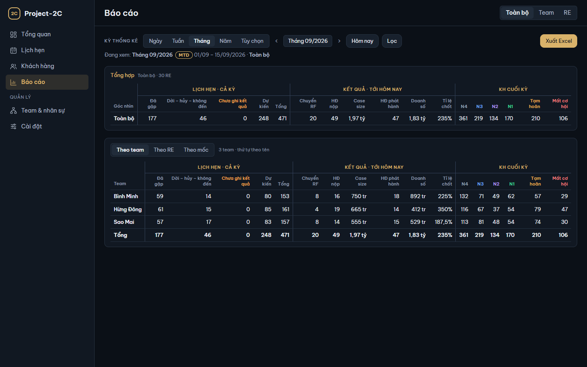
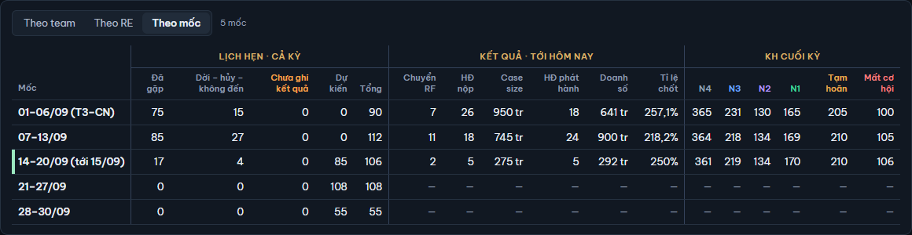

# 7. Báo cáo

[← Mục lục](README.md)

Màn Báo cáo đặt số liệu của một kỳ thành bảng: lịch hẹn, kết quả (6 chỉ số) và KH theo nhóm, chia theo team, theo RE hoặc theo từng mốc thời gian. Mọi bảng xuất được ra Excel.

## Chọn kỳ và góc nhìn

Hàng **Kỳ thống kê** và nút **Lọc** dùng như ở Tổng quan (xem [2. Tổng quan](02-tong-quan.md#chọn-kỳ-và-bấm-lọc)): chọn loại kỳ, lùi / tiến kỳ, chọn **Góc nhìn**, rồi bấm **Lọc**. Dòng **Đang xem:** cho biết bảng đang tính cho kỳ và góc nhìn nào.

Khác Tổng quan: ở Báo cáo, góc nhìn **Team** có ô chọn một team, và bảng chỉ tính team đó.

## Các cột

Mọi bảng có cùng ba nhóm cột:

| Nhóm cột | Cột | Tính thế nào |
|---|---|---|
| **Lịch hẹn · cả kỳ** | Đã gặp · Dời – hủy – không đến · Chưa ghi kết quả · Dự kiến · Tổng | Mọi lịch hẹn trong cả kỳ, kể cả lịch sau hôm nay; 4 nhóm như ô Lịch hẹn của [Tổng quan](02-tong-quan.md#ô-lịch-hẹn) |
| **Kết quả · tới hôm nay** | Chuyển RF · HĐ nộp · Case size · HĐ phát hành · Doanh số · Tỉ lệ chốt | 6 chỉ số như [Tổng quan](02-tong-quan.md#6-chỉ-số-của-kỳ), tính tới hôm nay |
| **KH cuối kỳ** | N4 · N3 · N2 · N1 · Tạm hoãn · Mất cơ hội | Số KH ở mỗi nhóm vào cuối ngày cuối kỳ (kỳ chưa hết: hôm nay), kể cả nhóm đã đóng |

Kỳ chưa bắt đầu thì Kết quả và KH cuối kỳ hiện "—". Tỉ lệ chốt hiện "—" khi không có RF.

## Tổng hợp

Bảng **Tổng hợp** luôn ở trên: một dòng cho cả góc nhìn đang xem (ví dụ "Toàn bộ · 30 RE").

## Theo team, Theo RE, Theo mốc

Bảng thứ hai chọn bằng ô **Theo team** / **Theo RE** / **Theo mốc**:

- **Theo team**: mỗi team một dòng, xếp theo tên, dòng **Tổng** ở cuối.
- **Theo RE**: mỗi RE một dòng (cột Team, RE), xếp theo team rồi tên, dòng **Tổng** ở cuối.
- **Theo mốc**: mỗi mốc thời gian của kỳ một dòng, cho góc nhìn đang xem. Không có dòng Tổng: cộng các mốc ra đúng bảng Tổng hợp.

Dòng **Tổng** cộng các dòng trên; Tỉ lệ chốt của dòng Tổng = tổng HĐ phát hành ÷ tổng RF, không lấy trung bình.

Bảng nào trùng Tổng hợp thì không có: góc nhìn Team không có Theo team; góc nhìn RE chỉ có Theo mốc.

### Theo mốc

| Loại kỳ | Mỗi mốc là |
|---|---|
| Ngày | Chính ngày đó (một dòng) |
| Tuần | Một ngày |
| Tháng | Một tuần Thứ Hai → Chủ nhật, cắt ở đầu và cuối tháng (ví dụ "01-06/09 (T3-CN)") |
| Năm | Một tháng |
| Tùy chọn | Một ngày (kỳ tới 31 ngày) hoặc một tháng (kỳ dài hơn) |

Mốc có hôm nay được đánh dấu và ghi "tới …" (ví dụ "14-20/09 (tới 15/09)"): kết quả của mốc đó tính tới hôm nay. Mốc sau hôm nay chỉ có lịch hẹn Dự kiến; Kết quả và KH cuối kỳ hiện "—".

## Xuất Excel

1. Chọn kỳ, góc nhìn, bấm **Lọc**.
2. Bấm **Xuất Excel** (góc phải hàng Kỳ thống kê). Nút ghi "Đang xuất…" trong lúc tạo file.

File `.xlsx` có mỗi bảng đang có một sheet (Tổng hợp, rồi các bảng của góc nhìn): Toàn bộ 4 sheet, Team 3 sheet, RE 2 sheet. Dòng đầu mỗi sheet ghi tên bảng, kỳ, góc nhìn và ngày xuất. Ô giữ số thật (tiền theo đồng, tỉ lệ dạng %) để tính tiếp trong Excel.

- (bản exe) File lưu vào `Project2C-data\exports\`, tên dạng `bao-cao_<kỳ>_<góc nhìn>_<ngày xuất>.xlsx`, ví dụ `bao-cao_2026-10_toan-bo_2026-10-15.xlsx`. App báo "Đã xuất báo cáo · 4 sheet: …" kèm đường dẫn và nút **Mở thư mục**.
- Bản web: file tải về thư mục tải xuống của trình duyệt.

Không xuất được (ổ đĩa đầy, không có quyền ghi): app báo **Không xuất được báo cáo** kèm lý do. Dữ liệu trong app không bị ảnh hưởng; sửa lỗi rồi bấm lại.

Thông báo xuất gắn với kỳ và góc nhìn lúc bấm; bấm **Lọc** với kỳ khác thì thông báo mất.

[← 6. KYC Intelligence](06-ai.md) · [8. Team & nhân sự →](08-team.md)
