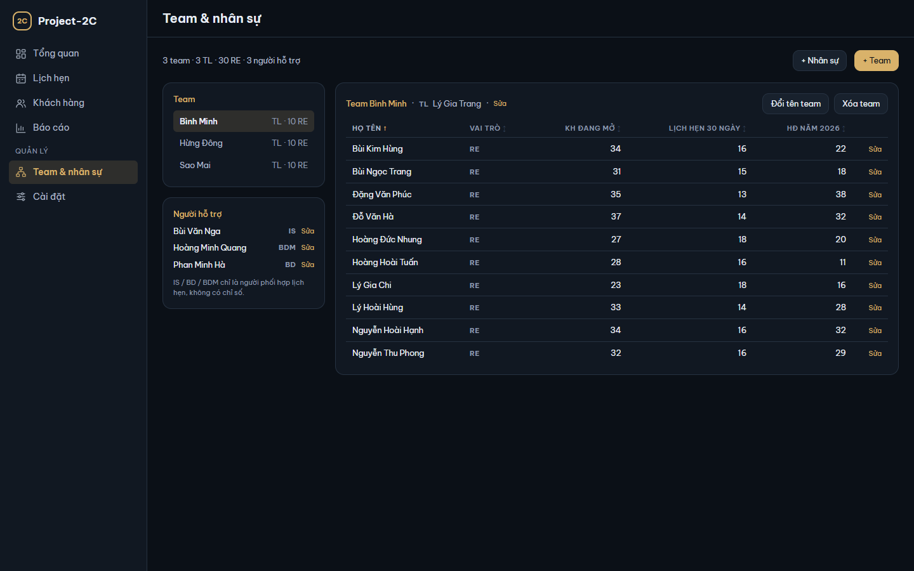
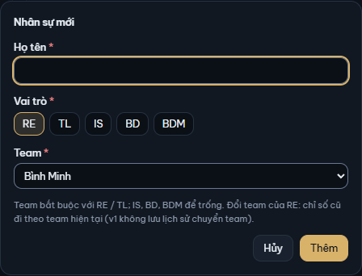

# 8. Team & nhân sự

[← Mục lục](README.md)

Màn **Team & nhân sự** (nhóm Quản lý ở sidebar) quản lý các team và mọi người trong app. Đầu màn đếm, ví dụ "3 team · 3 TL · 30 RE · 3 người hỗ trợ".

## Vai trò

| Vai trò | Là ai | Thuộc team | Có chỉ số |
|---|---|---|---|
| **RE** | Người tư vấn: phụ trách KH, ghi lịch hẹn, kết quả, HĐ | Có, bắt buộc | Có |
| **TL** | Trưởng team, mỗi team một TL | Có, bắt buộc | Không |
| **IS**, **BD**, **BDM** | Người hỗ trợ dùng chung cho mọi team | Không | Không |

Chỉ RE có chỉ số. TL, IS, BD, BDM là **người phối hợp** trong lịch hẹn và có thể là **người đánh giá kết quả** cuộc gặp (xem [3. Lịch hẹn](03-lich-hen.md)); họ không phụ trách KH. Nghĩa đầy đủ ở [11. Thuật ngữ](11-thuat-ngu.md#người-và-góc-nhìn).

## Xem team

- Khung **Team** bên trái liệt kê các team, mỗi team ghi "TL · … RE" hoặc "chưa có TL · … RE". Bấm một team để xem bên phải.
- Khung **Người hỗ trợ** liệt kê IS / BD / BDM, mỗi người có nút **Sửa**.
- Bên phải: tên team, TL (kèm **Sửa**) hoặc "chưa có TL" kèm **+ Thêm TL**; nút **Đổi tên team** và **Xóa team**.

Bảng thành viên chỉ liệt kê RE của team. Bấm tiêu đề cột để sắp xếp:

| Cột | Đếm gì |
|---|---|
| **Họ tên**, **Vai trò** | |
| **KH đang mở** | KH RE đang phụ trách ở nhóm N4–N1 |
| **Lịch hẹn 30 ngày** | Lịch hẹn của RE trong 30 ngày tính tới hôm nay (kể cả hôm nay) |
| **HĐ năm …** | HĐ của RE phát hành trong năm nay |

Mỗi dòng có **Sửa**. Team có hơn 100 RE thì bảng có nút "Hiện thêm … người" ở cuối.

## Tạo, đổi tên, xóa team

**Tạo team:** bấm **+ Team**, gõ **Tên team** ở hộp **Team mới**, bấm **Tạo team**. Tên trùng một team đang có thì hộp báo "Đã có team "…"." và không lưu.

**Đổi tên:** chọn team, bấm **Đổi tên team**, sửa tên, bấm **Lưu**.

**Xóa team:**

1. Chọn team, bấm **Xóa team**.
2. Hộp **Xóa team …?** ghi "Team được xóa mềm: ẩn khỏi danh sách, dữ liệu cũ vẫn giữ; khôi phục ở Cài đặt → Thùng rác."
3. Bấm **Xóa**.

Team còn người thì không xóa được: hộp báo "Team còn nhân sự: chuyển hoặc xóa hết nhân sự trước khi xóa team." Bấm **Đóng**, chuyển từng người sang team khác (Sửa) hoặc xóa họ, rồi xóa team.

## Thêm người

1. Bấm **+ Nhân sự** (hoặc **+ Thêm TL** ở team chưa có TL: vai trò chọn sẵn TL).
2. **Họ tên**.
3. **Vai trò**: RE, TL, IS, BD hoặc BDM.
4. **Team**: bắt buộc với RE và TL (mặc định team đang chọn); IS, BD, BDM chọn "Không thuộc team".
5. Bấm **Thêm**.

Mỗi team chỉ một TL: thêm TL thứ hai, hộp báo "Team này đã có TL: …".

## Sửa người

Bấm **Sửa** cạnh người đó. Hộp **Sửa nhân sự** sửa được họ tên, vai trò, team; bấm **Lưu**.

- *Đổi team của RE*: chỉ số cũ của RE đi theo team mới (app không lưu lịch sử chuyển team). Lịch hẹn và HĐ vẫn tính cho đúng RE đó.
- *Đổi vai trò của RE* không được khi RE còn KH, lịch hẹn hoặc HĐ, kể cả của KH đã xóa (khôi phục KH cần RE này). Chuyển KH sang RE khác bằng **Sửa hồ sơ** KH trước; lịch hẹn và HĐ cũ vẫn giữ RE đã ghi, nên RE đã có hoạt động thường giữ nguyên vai trò.
- *Đổi người hỗ trợ thành RE* không được khi họ còn là người phối hợp hay người đánh giá kết quả của một lịch hẹn chưa xóa, vì RE không phối hợp, không đánh giá. Bỏ họ khỏi người phối hợp / người đánh giá của các lịch đó trước.

## Xóa người

1. Bấm **Sửa** cạnh người đó, rồi **Xóa nhân sự**.
2. Hộp **Xóa …?** ghi vai trò và team.
3. Người không còn dữ liệu: hộp ghi "Nhân sự được xóa mềm: ẩn khỏi danh sách, dữ liệu cũ vẫn giữ; khôi phục ở Cài đặt → Thùng rác." Bấm **Xóa**.

Người còn dữ liệu thì nút Xóa tắt và hộp ghi "Chưa xóa được — … còn dữ liệu", kèm số KH đang phụ trách, số lịch hẹn và HĐ ghi cho RE này, số lịch hẹn là người phối hợp. RE đã có lịch hẹn hay HĐ thì không xóa được, vì các bản ghi đó giữ tên RE; cân nhắc giữ lại thay vì xóa. Chỉ khi mọi bản ghi đó thuộc KH đã xóa, hộp ghi thêm tên các KH đó, và người này xóa được sau khi dọn sạch Thùng rác (xem [9. Cài đặt → Dọn sạch Thùng rác](09-cai-dat.md#dọn-sạch-thùng-rác)).

Người và team đã xóa khôi phục ở [Cài đặt → Thùng rác](09-cai-dat.md#cài-đặt--thùng-rác).

[← 7. Báo cáo](07-bao-cao.md) · [9. Cài đặt →](09-cai-dat.md)
