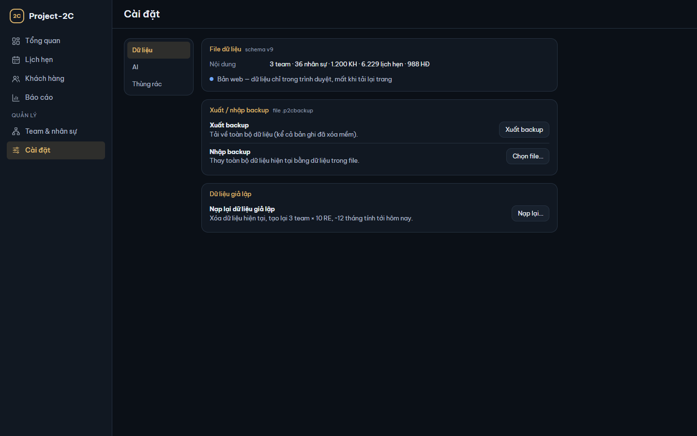
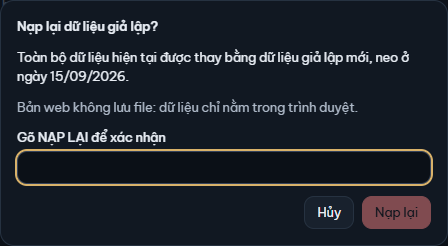
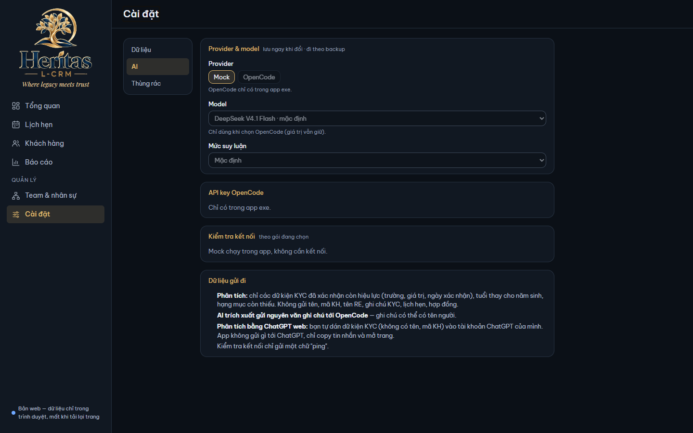
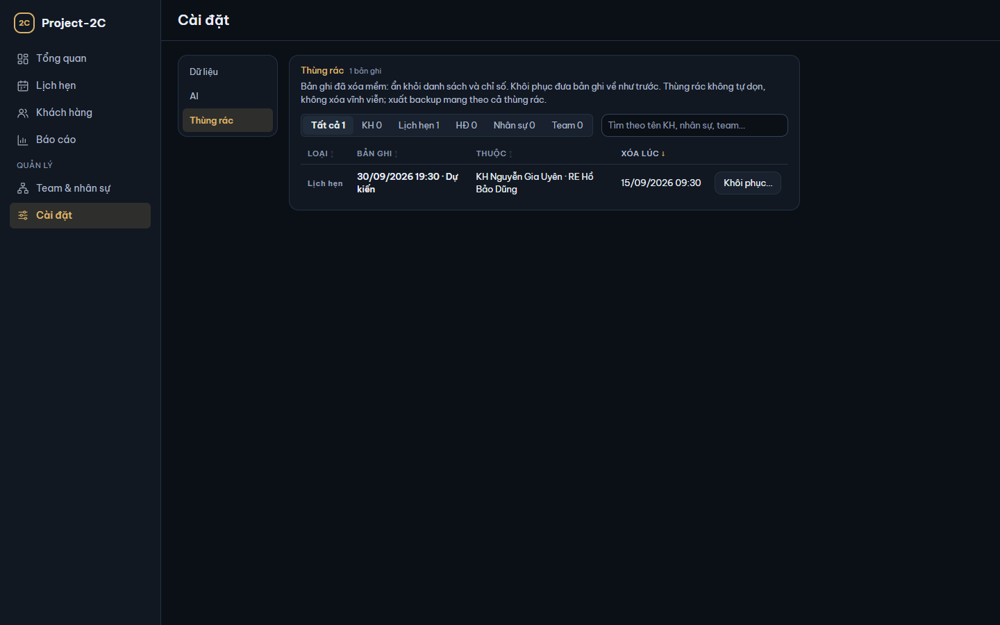
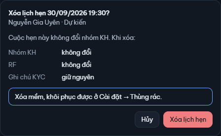

# 9. Cài đặt

[← Mục lục](README.md)

Màn **Cài đặt** (nhóm Quản lý ở sidebar) có ba mục ở khung trái: **Dữ liệu**, **AI**, **Thùng rác**.

## Cài đặt → Dữ liệu

Ảnh chụp từ bản web. Bản exe có thêm vài dòng về file, ghi ở dưới.

### File dữ liệu

Thẻ **File dữ liệu** (kèm phiên bản schema của app):

- **Nội dung**: số team, nhân sự, KH, lịch hẹn, HĐ đang có (không tính bản ghi đã xóa).
- (bản exe) **Vị trí**: `Project2C-data\project2c.db` (cạnh file exe).
- (bản exe) **Lưu lần cuối**: giờ và cỡ file của lần lưu gần nhất ("—" khi chưa lưu lần nào từ lúc mở app).
- (bản exe) **Backup tự động**: "Mỗi lần mở app · giữ 10 bản mới nhất ở `Project2C-data\backups\`", kèm tên bản mới nhất và nút **Mở thư mục**.
- Bản web ghi "Bản web — dữ liệu chỉ trong trình duyệt, mất khi tải lại trang".

Thư mục `Project2C-data\` giải thích ở [1. Bắt đầu](01-bat-dau.md#thư-mục-project2c-data-bản-exe).

### Xuất backup

Bấm **Xuất backup**. App ghi toàn bộ dữ liệu, kể cả bản ghi đã xóa mềm (Thùng rác) và cài đặt AI, vào một file `.p2cbackup`:

- (bản exe) File nằm trong `Project2C-data\exports\`. App báo "Đã xuất backup: … · …" (đường dẫn, cỡ file) kèm nút **Mở thư mục**.
- Bản web: file tải về thư mục tải xuống của trình duyệt.

API key OpenCode không nằm trong backup.

### Nhập backup

Nhập backup **thay toàn bộ** dữ liệu hiện tại bằng dữ liệu trong file, không gộp.

1. Bấm **Chọn file…** ở dòng **Nhập backup**, chọn file `.p2cbackup`. Nút ghi "Đang đọc file…" trong lúc đọc.
2. Hộp **Thay toàn bộ dữ liệu?** cho so sánh:
   - **Xuất lúc**: thời điểm file được xuất.
   - **Phiên bản**: schema của file. File từ bản app cũ hơn vẫn nhập được: "app tự nâng cấp dữ liệu sau khi nhập".
   - **Trong file** và **Hiện tại**: số team, nhân sự, KH, lịch hẹn, HĐ.
   - Cảnh báo "Mọi thay đổi sau … sẽ mất khỏi app" (ngày giờ xuất của file).
3. (bản exe) Bấm **Backup rồi thay dữ liệu**: app chép dữ liệu hiện tại vào `Project2C-data\backups\` trước, rồi mới thay. Bản web bấm **Thay dữ liệu**.
4. Xong, app báo "Đã nhập backup xuất lúc …", bản exe kèm tên file backup vừa tạo.

Bấm **Hủy** để thôi, dữ liệu không đổi.

App từ chối file không đúng, hộp **Không nhập được file** nêu lý do; dữ liệu hiện tại không bị đổi:

| Lý do | Làm gì |
|---|---|
| File tạo từ bản app mới hơn | Cập nhật app rồi nhập lại |
| File lớn hơn giới hạn app đọc | Kiểm tra lại file đã chọn: backup của Project-2C nhỏ hơn nhiều |
| File hỏng hoặc không phải backup Project-2C | Chỉ nhận file `.p2cbackup` do Project-2C xuất |

Trong lúc đang nhập, app không nhận thay đổi khác (xem [10. Khi có lỗi](10-su-co.md#đang-thay-toàn-bộ-dữ-liệu)).

*Làm trên hai máy:* xuất ở máy đang dùng trước khi rời máy, nhập ở máy kia. *Bản nhập sau thắng*: nhập đè mất các thay đổi chưa xuất của máy bị nhập (bản exe vẫn còn bản trước khi nhập trong `backups\`). Xem [Làm trên hai máy](README.md#làm-trên-hai-máy).

### Nạp lại dữ liệu giả lập

Xóa dữ liệu hiện tại và tạo lại dữ liệu giả lập: 3 team × 10 RE, khoảng 12 tháng tính tới hôm nay.

1. Bấm **Nạp lại…**.
2. Hộp **Nạp lại dữ liệu giả lập?** ghi số KH, lịch hẹn, HĐ sắp bị thay và ngày neo của dữ liệu mới. (bản exe) App backup file dữ liệu vào `Project2C-data\backups\` trước.
3. Gõ đúng `NẠP LẠI` vào ô "Gõ NẠP LẠI để xác nhận".
4. (bản exe) Bấm **Backup rồi nạp lại**; bản web bấm **Nạp lại**.

Muốn lấy lại dữ liệu trước khi nạp lại (bản exe): đóng app, chép bản backup trong `Project2C-data\backups\` thành `Project2C-data\project2c.db`.

Lần lưu gần nhất bị lỗi thì app không nhập backup, không nạp lại ("…backup sẽ thiếu các thay đổi đó. Bấm "Thử lại" ở dải cảnh báo đầu màn…"). Xử lý lỗi lưu, bấm **Thử lại** ở dải cảnh báo, lưu được rồi thì làm lại (xem [1. Bắt đầu](01-bat-dau.md#khi-app-chưa-lưu-được-bản-exe)).

## Cài đặt → AI

### Provider & model

Thẻ **Provider & model** lưu ngay khi đổi và đi theo backup.

- **Provider**: **Mock** (câu mẫu cố định, không gọi mạng, chỉ để thử app) hoặc **OpenCode** (gọi model thật, chỉ có trong bản exe). Cách dùng AI ở [6. KYC Intelligence](06-ai.md).
- (bản exe) **Gói OpenCode** (chỉ hiện khi chọn OpenCode): **Gói Go** (trả theo tháng, có giới hạn dùng) hoặc **Credit** (trừ vào số dư credit, xem số dư trên dashboard OpenCode). Cùng một API key, cùng danh sách model.
- **Model**: chọn trong danh sách cố định của app; model mặc định ghi "· mặc định". Chỉ dùng khi chọn OpenCode.
- **Mức suy luận**: **Mặc định**, **Thấp**, **Vừa**, **Cao**. Model chưa được kiểm với mức suy luận thì app dùng Mặc định.

Cài đặt đã lưu không hợp lệ (ví dụ nhập backup có model không còn trong danh sách) thì thẻ báo đang dùng mặc định; chọn lại để lưu.

### API key OpenCode (bản exe)

Bản web ghi "Chỉ có trong app exe."

1. Lấy key trên trang OpenCode.
2. Dán vào ô **Key** (đã có key thì ô **Key mới**, để thay key cũ).
3. Bấm **Lưu key**. App báo "Đã lưu key."

Key lưu trong Windows Credential Manager của máy này: không vào file dữ liệu, không vào backup, không bao giờ hiện lại. Mỗi máy nhập key riêng. Đầu thẻ ghi **Đã có key** hoặc **Chưa có key**.

**Xóa key:** bấm **Xóa key…**. Hộp **Xóa API key OpenCode?** ("chỉ trên máy này") cho biết sau khi xóa, Phân tích và AI trích xuất với OpenCode báo chưa có key tới khi nhập key mới; lịch sử phân tích không đổi. Bấm **Xóa key**, hoặc **Hủy**.

### Kiểm tra kết nối

Bấm **Kiểm tra kết nối** để thử key và gói đang chọn. App chỉ gửi một chữ "ping". Được thì báo "Kết nối được" kèm gói và model; không được thì báo lỗi như ở [10. Khi có lỗi](10-su-co.md#lỗi-ai-thường-gặp). Với Mock: "Mock chạy trong app, không cần kết nối."

### Dữ liệu gửi đi

Thẻ cuối ghi rõ app gửi gì khi Phân tích, AI trích xuất, ChatGPT web và Kiểm tra kết nối (xem [6. KYC Intelligence](06-ai.md#dữ-liệu-gửi-đi)).

## Cài đặt → Thùng rác

KH, lịch hẹn, HĐ, nhân sự và team khi xóa là **xóa mềm**: ẩn khỏi danh sách và chỉ số nhưng vẫn còn trong dữ liệu. Thùng rác liệt kê các bản ghi đó để khôi phục. Thùng rác không tự dọn; nút **Dọn sạch Thùng rác…** xóa hẳn mọi bản ghi ở đây (xem [Dọn sạch Thùng rác](#dọn-sạch-thùng-rác)). Xuất backup mang theo cả Thùng rác, nhập backup / nạp lại thay cả Thùng rác. Ghi chú KYC không xóa riêng được nên không nằm ở đây; dọn sạch xóa hẳn cả ghi chú KYC của KH đã xóa.

Thùng rác không theo góc nhìn: luôn hiện mọi bản ghi đã xóa.

### Tìm bản ghi

- Ô **Loại bản ghi**: **Tất cả**, **KH**, **Lịch hẹn**, **HĐ**, **Nhân sự**, **Team**, mỗi loại có số đếm.
- Ô "Tìm theo tên KH, nhân sự, team…": lịch hẹn và HĐ tìm theo tên KH.

Bảng **Bản ghi đã xóa**, mới xóa nhất ở trên:

| Cột | Ghi gì |
|---|---|
| **Loại** | KH, Lịch hẹn, HĐ, Nhân sự, Team |
| **Bản ghi** | KH: tên, nhóm, số bản ghi sẽ hiện lại ("khôi phục kèm … lịch hẹn · … HĐ · … ghi chú KYC"). Lịch hẹn: ngày giờ, trạng thái / kết quả. HĐ: "Nộp … · FYP". Nhân sự: tên, vai trò. Team: tên |
| **Thuộc** | KH, RE, team của bản ghi; bản ghi cha cũng đã xóa thì ghi "(đã xóa)" |
| **Xóa lúc** | Ngày giờ xóa |

Thùng rác trống thì ghi "Thùng rác trống".

### Khôi phục

1. Bấm **Khôi phục…** ở dòng cần khôi phục.
2. Hộp **Khôi phục …?** cho biết điều sẽ xảy ra:
   - **KH**: nhóm, RE, và mục **Hiện lại cùng KH**: số lịch hẹn (đã gặp, lần tính RF), HĐ, ghi chú KYC, phân tích AI. Lịch hẹn / HĐ đã xóa riêng trước khi xóa KH vẫn ở Thùng rác, khôi phục riêng sau.
   - **Lịch hẹn** Đã gặp đã chuyển nhóm KH (lúc xóa, app hủy chuyển nhóm đó): kết quả và nhóm sau cuộc gặp, nhóm KH hiện tại, rồi một trong hai:
     - "Nhóm KH: … → … từ …": app ghi lại chuyển nhóm của cuộc gặp vào đúng ngày cuộc hẹn, và cho biết có tính RF không.
     - "Nhóm KH giữ …": KH đã ở nhóm sau cuộc gặp ngay trong ngày cuộc hẹn nên không ghi thêm chuyển nhóm; cuộc hẹn này không tính RF. KH tới nhóm đó vào ngày sau thì lịch không khôi phục được (nhóm KH đã đổi sau ngày cuộc hẹn).
   - **Lịch hẹn** Đã gặp giữ nguyên nhóm (hộp xóa đã ghi "Cuộc hẹn này không đổi nhóm KH"): kết quả và nhóm sau cuộc gặp, rồi "Không đổi nhóm KH". Lịch về đúng như lúc xóa, kể cả khi nhóm KH đã đổi sau đó. Chỉ bị chặn khi nhóm của chính ngày cuộc hẹn đã đổi trong lúc lịch nằm ở Thùng rác (vd. đã xóa một cuộc gặp trước đó có chuyển nhóm).
   - **Lịch hẹn** khác (Dự kiến, Hủy, Không đến…): "Không đổi nhóm KH". Lịch Dự kiến đã qua ngày hiện lại ở nhóm "Chưa ghi kết quả".
   - **HĐ**: ngày nộp, FYP nộp, ngày và FYP phát hành nếu có.
   - **Nhân sự**, **Team**: vai trò, team. Khôi phục team chưa kèm thành viên: khôi phục từng người sau.
3. Bấm **Khôi phục**.

Xong, dòng biến khỏi bảng và app báo "Đã khôi phục …" kèm nút **Mở hồ sơ** (KH, lịch hẹn, HĐ) hoặc **Mở Team & nhân sự** (nhân sự, team).

Khôi phục không kéo theo bản ghi khác: mỗi bản ghi khôi phục riêng.

### Khi không khôi phục được

Khi bản ghi cần một bản ghi khác đã xóa hoặc đã đổi, nút **Khôi phục…** tắt và dòng ghi lý do, nêu tên bản ghi chặn và việc cần làm trước. Ví dụ:

| Lý do trên màn | Làm gì |
|---|---|
| "Khôi phục KH … trước." | Khôi phục KH (cũng trong Thùng rác), rồi khôi phục lịch hẹn / HĐ |
| "RE … đã xóa — khôi phục RE trước." | Khôi phục RE ở loại Nhân sự trước |
| "… nay là TL, không phụ trách KH được — đổi lại vai trò RE trước." | Đổi vai trò người đó về RE ở [Team & nhân sự](08-team.md#sửa-người) |
| "Người phối hợp … đã xóa — khôi phục trước." / "Người đánh giá … đã xóa — khôi phục trước." | Khôi phục người đó trước |
| "Nhóm KH đã đổi ngày …, sau ngày cuộc hẹn này — không ghi chuyển nhóm lùi ngày (D10)." | Không khôi phục được cuộc gặp này: nhóm KH đã đổi sau ngày gặp, hoặc đã đổi chính ngày gặp nhưng sau lúc xóa lịch. Chỉ gặp với cuộc gặp đã chuyển nhóm KH |
| "KH đang Mất cơ hội, chỉ mở lại được về N3 — không chuyển sang N2." | Không khôi phục được cuộc gặp này khi KH đang ở nhóm đóng |
| "Khôi phục team … trước." | Khôi phục team trước, rồi khôi phục người |
| "Sao Mai đã có TL Nguyễn Thu Hà." | Team đã có TL khác: đổi vai trò một trong hai người trước |
| "Đã có team … — đổi tên team kia trước." | Đổi tên team đang dùng, rồi khôi phục |
| "Ngày nộp … sau hôm nay." / "Kết quả ngày … sau hôm nay." | Bản ghi đến từ file nhập có ngày tương lai: chờ tới ngày đó |

Lý do được tính trước khi bấm; nếu dữ liệu vừa đổi, hộp khôi phục báo lỗi và không đổi gì.

### Dọn sạch Thùng rác

Nút **Dọn sạch Thùng rác…** ở đầu thẻ xóa hẳn mọi bản ghi trong Thùng rác, không theo loại hay ô tìm đang chọn. App không có xóa hẳn từng dòng và không bao giờ tự dọn. Thùng rác từ 1.000 bản ghi trở lên mở chậm dần, nên dưới câu giới thiệu có câu nhắc dọn.

1. Bấm **Dọn sạch Thùng rác…**.
2. Hộp **Dọn sạch Thùng rác?** đếm những gì sẽ bị xóa hẳn:
   - KH, kèm lịch hẹn, HĐ, ghi chú KYC, phân tích AI của các KH đó;
   - lịch hẹn, HĐ đã xóa riêng;
   - nhân sự, team.

   Hộp nói rõ việc này không hoàn tác được, còn dữ liệu đang dùng và chỉ số không đổi.
3. Gõ **DỌN SẠCH** vào ô xác nhận, rồi bấm **Backup rồi dọn sạch** (bản exe) hoặc **Dọn sạch** (bản web). Trong lúc dọn, nút ghi "Đang dọn…" và hộp không đóng được.

Dọn xong, app báo "Đã dọn sạch Thùng rác", kèm số bản ghi đã xóa hẳn theo loại và tên file backup (bản exe).

- **Backup trước (bản exe):** app chờ lưu xong, rồi chép file dữ liệu vào `Project2C-data\backups\` trước khi dọn. Muốn lấy lại dữ liệu như trước lúc dọn: đóng app, chép bản backup đó thành `Project2C-data\project2c.db`; các thay đổi sau lúc dọn sẽ mất. Bản web không lưu file nên không có backup.
- **Không dọn được:** có ba trường hợp, và cả ba đều để dữ liệu không đổi:
  - lần lưu gần nhất bị lỗi: app báo "Chưa dọn: lần lưu gần nhất bị lỗi…" kèm cách làm: bấm **Thử lại** ở dải cảnh báo đầu màn, lưu được rồi thì dọn lại;
  - backup lỗi;
  - lỗi giữa chừng.

  Hai trường hợp sau báo "Chưa dọn được Thùng rác.".
- **File nhỏ lại:** dọn xong, app thu gọn file dữ liệu. Nếu riêng bước thu gọn bị lỗi, dữ liệu vẫn đã được dọn và app vẫn báo dọn xong; file chỉ chưa nhỏ lại, chờ tới lần dọn sau.
- **Bản ghi được giữ lại:** bản ghi mà dữ liệu còn lại vẫn dùng tới thì không bị dọn. Dòng của nó ghi lý do, hiện cả trước khi dọn:

  | Lý do trên màn | Nghĩa |
  |---|---|
  | "Giữ lại khi dọn: lịch … dời từ lịch này." | Lịch Dời lịch đã xóa (chỉ có khi nhập từ file) mà lịch mới dời từ nó vẫn còn |
  | "Giữ lại khi dọn: lịch … còn ghi người này." | Nhân sự đã xóa, là RE, người phối hợp hoặc người đánh giá của một lịch được giữ |
  | "Giữ lại khi dọn: nhân sự … còn thuộc team này." | Team đã xóa của một nhân sự được giữ |

  Khi có bản ghi được giữ, hộp dọn sạch ghi "Giữ lại … bản ghi còn được dùng". Nếu mọi bản ghi còn lại đều được giữ thì nút **Dọn sạch Thùng rác…** tắt.
- Nhân sự chỉ còn dữ liệu của KH đã bị dọn thì xóa được (xem [8. Team & nhân sự](08-team.md#xóa-người)).

### Mở hộp xóa từ đâu

Mỗi hộp xóa ghi chỗ khôi phục ("… khôi phục ở Cài đặt → Thùng rác."):

| Xóa gì | Ở đâu |
|---|---|
| Lịch hẹn | [3. Lịch hẹn → Xóa lịch hẹn](03-lich-hen.md#xóa-lịch-hẹn) |
| KH | [4. Khách hàng → Xóa KH](04-khach-hang.md#xóa-kh) |
| HĐ | [5. Hồ sơ KH → Sửa, xóa HĐ](05-ho-so-kh.md#sửa-xóa-hđ) |
| Nhân sự, team | [8. Team & nhân sự](08-team.md#xóa-người) |

[← 8. Team & nhân sự](08-team.md) · [10. Khi có lỗi →](10-su-co.md)
